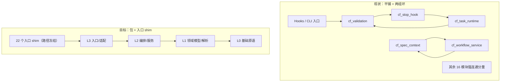

# 运行时收敛与分层演进 模块需求与设计一体化文档

> **文档编号**: MOD-RTC-001-v1.0
> **文档版本**: v0.1
> **创建日期**: 2026-10-26
> **文档状态**: 草稿

> **评审边界说明**:
> - 需求评审：第 2 章（需求分析）→ 通过后锁定需求基线
> - 设计评审：第 3-4 章（技术设计 + 部署运维）→ 通过后锁定设计基线
> - 交接契约：2.5 验收条件——需求定义 What，设计实现 How

> **填写约定**: 表内数值/阈值均为本方案的真实目标；无实测依据的写“待定”，不照抄模板示例。接口只使用 CLI（形态 B）与函数库（形态 C）两种形态。

---

## 1. 文档控制

### 1.1 责任人

| 角色 | 姓名 | 职责范围 |
|------|------|---------|
| 开发负责人 | jahan | 技术方案、代码实现 |
| 测试负责人 | jahan | 测试策略、质量保证 |

### 1.2 修订历史

| 版本 | 日期 | 作者 | 变更描述 |
|------|------|------|---------|
| v0.1 | 2026-10-26 | jahan | 初始草稿：基于仓库审计与依赖实测结论 |

---

## 2. 需求分析

### 2.1 需求概述

| 项目 | 内容 |
|------|------|
| **模块名称** | code-flow runtime（Python 脚本层 + CLI 安装层） |
| **模块ID** | MOD-RTC-001 |
| **所属系统/产品线** | code-flow |
| **需求类型** | 技术重构 / 架构演进 |
| **业务背景** | 从 v0.8.0-rc.1 到当前工作树，Python 模块 47→59、物理行 17,809→20,816；审计确认三处契约分歧、两组依赖环与 33 个跨模块私有符号导入。 |
| **核心目标** | 让同一事实只有一个权威解释，依赖严格单向，公共原语可复用；在同一部署协议下完成包化演进。 |

### 2.2 痛点与价值

| 维度 | 内容 |
|------|------|
| **目标用户** | code-flow 维护者、四个平台的 Hook 使用者、依赖验收门禁的 AI agent |
| **当前问题** | ① 同一份损坏的 `validation.yml` 在 validate/Stop/finish 得到三种结论；② 同一份 TASK 文档被 7 处解析器读出不同状态；③ npm 安装产物漏 2 条运行时 ignore；④ 16 模块 + 3 模块两组依赖环；⑤ 33 个跨模块私有符号被直接导入。 |
| **业务影响** | 门禁结论不可预测，安装产物与源码模板漂移，维护者需要同时理解多套等价实现；新增修复容易落到“测试通过但 live 行为不变”。 |
| **预期价值** | 三处契约分歧消除；依赖环归零；私有跨模块导入归零；单次 `verify_plan` 的重复读取下降；后续分层与模块拆分不再需要兼容性补救。 |

**用户故事**

| 编号 | 用户故事 | 优先级 |
|------|---------|--------|
| US-01 | 作为维护者，我希望同一配置/文档在所有入口得到一致结论，以便信任门禁结果 | P0 |
| US-02 | 作为使用者，我希望安装产物与模板声明一致，以便忽略项完整 | P0 |
| US-03 | 作为维护者，我希望依赖方向可自动校验，以便新增代码不会重新制造环 | P0 |
| US-04 | 作为维护者，我希望公共能力只有一份实现，以便修一处即全链路生效 | P1 |
| US-05 | 作为维护者，我希望最终目录表达分层，但不破坏四平台部署协议 | P1 |

### 2.3 功能方案

#### 2.3.1 功能清单

| 功能ID | 功能名称 | 功能描述 | 优先级 | 来源 |
|--------|---------|---------|--------|------|
| FEAT-01 | 安装资源单一来源 | 运行时 ignore 由 canonical 声明驱动，CLI/迁移器/源模板/部署副本一致；真实 npm 安装补齐缺项 | P0 | 审计 A3 |
| FEAT-02 | validator 契约统一 | 配置读取、状态判别与执行归入 validator 引擎；validate/Stop/finish 消费同一结果 | P0 | 审计 A1/A4 |
| FEAT-03 | TASK 文档单一解析 | 7 处 TASK 段落解析收敛为 1 个纯解析器；重复 ID、围栏、行内示例规则统一 | P0 | 审计 A2 |
| FEAT-04 | 公共原语抽离 | Git、原子文件 IO、诊断日志、Markdown/表格解析收口为 L0/L1 模块 | P1 | 审计 A5 补充 |
| FEAT-05 | 旧路径与导航清理 | 删除无生产调用的旧 Spec 函数与专属词表，修正过期导航 | P1 | 审计 A5 |
| FEAT-06 | 单次操作快照 | `verify_plan` 一次加载并在子步骤间复用已验证快照，不加持久缓存 | P1 | 审计 A6 |
| FEAT-07 | 分层契约守卫 | 依赖方向与跨模块私有符号守卫测试，采用基线 allowlist + 棘轮 | P0 | 本设计补充 |
| FEAT-08 | 包化与入口 shim | 37 个无外部路径模块进入 `codeflow/` 包；22 个外部入口保持路径不变并退化为 shim | P1 | 本设计补充 |

#### 2.3.2 字段约束

> 本需求没有数据库字段。涉及的结构化数据约束见 §3.3。

### 2.4 范围与边界

| 类别 | 内容 |
|------|------|
| **范围（In Scope）** | 审计 A1/A2/A3/A4/A5/A6 的契约收敛；分层守卫测试；公共原语抽离；条件触发的包化搬迁；对应测试、迁移与文档更新。 |
| **非范围（Out of Scope）** | A7 四平台正文生成；A8 大模块按职责重组（`cf_spec_context` 的 model/lock/CLI 拆分）；模块数量目标；新增运行时依赖或持久缓存；入口 dispatcher 合并。 |
| **前置假设** | 当前工作树先冻结为可独立审查的提交；Python 3.9+；运行时仅依赖 pyyaml；四平台部署协议不变；双副本同步规则继续有效。 |
| **有意妥协 / 技术债** | 过渡期允许一份有到期批次的私有导入 allowlist；包化后保留一个发布版本的入口 shim 兼容窗口；`cf_spec_context` 在包化后仍保持混合职责，拆分另立需求。 |

### 2.5 验收条件

#### 2.5.1 业务规则与约束

| ID | 类型 | 描述 | 验证场景 |
|----|------|------|---------|
| RULE-01 | 系统约束 | 同一份损坏的 `validation.yml` 在 validate、Stop、finish 必须得到一致的阻断结论与错误码 | S-03, E-02 |
| RULE-02 | 系统约束 | TASK 文档只有一份解析权威；重复 TASK ID 在所有入口一致拒绝，禁止首/末条择一 | S-07, S-09, E-03 |
| RULE-03 | 系统约束 | 运行时 ignore 只有一个 canonical 声明；源模板、CLI、迁移器、部署副本与 npm 产物一致 | S-01, S-02, B-01, E-01 |
| RULE-04 | 架构约束 | 依赖方向单向：L0/L1 不得导入 L2/L3；顶层导入图与延迟导入图均无环 | S-15, S-16 |
| RULE-05 | 架构约束 | 跨模块只允许公开符号导入；`from cf_x import _y` 必须为零或处于有到期批次的 allowlist | S-16 |
| RULE-06 | 部署约束 | 22 个外部固定模块路径不变；四个平台的 hook 命令与 runtime 命令注册保持可用 | S-17, S-19 |
| RULE-07 | 系统约束 | 不新增运行时依赖、持久缓存或常驻扫描命令；守卫以测试形式存在 | S-14, S-15, S-16 |
| RULE-08 | 系统约束 | `src/core/code-flow/` 与 `.code-flow/`、模板与四平台适配保持 canonical parity | S-19 |
| RULE-09 | 系统约束 | Hook stdout 始终为合法 JSON；异常只写 stderr，no-op 场景静默 | E-02, S-17 |
| RULE-10 | 系统约束 | 包化迁移遵循 dry-run、备份、journaled apply、回滚、幂等与版本最后提交 | S-18, E-05 |

#### 2.5.2 功能验收场景

> 场景唯一源：`runtime-consolidation.scenarios.md`。本表只说明设计影响，不复制执行元数据。

| 场景ID | 设计影响 / 备注 |
|--------|----------------|
| S-01 | 真实打包安装链路；涉及 §4.1 部署与 §3.4 CLI |
| S-02 | 升级合并策略；涉及 §3.4 函数接口与 §4.4 迁移 |
| B-01 | 用户自有 ignore 文件边界；涉及 §3.4 |
| E-01 | 守卫测试进入默认测试入口；涉及 §3.5 |
| S-03 | validator 三入口；涉及 §3.2 引擎层与 §3.4 API-01/02 |
| S-04 | 缺失配置与损坏配置的区分；涉及 §3.3 状态模型 |
| S-05 | heavy 阶段策略不变；涉及 §3.5 |
| E-02 | Stop JSON 协议；涉及 §3.4 与 RULE-09 |
| S-06 | TASK 标题边界；涉及 §3.4 API-03 |
| S-07 | 重复 ID 一致拒绝；涉及 §3.3 TaskDocument |
| S-08 | 缺 Status 的默认值；涉及 §3.3 |
| S-09 | 真实任务闭环；涉及 §3.2 编排层 |
| E-03 | plan gate 对重复 ID 的阻断；涉及 §3.4 |
| S-10 | Git 原语；涉及 §3.4 API-05 |
| S-11 | 原子写；涉及 §3.4 API-06 |
| S-12 | Markdown/表格解析；涉及 §3.4 API-07 |
| S-13 | 旧路径删除后行为不变；涉及 §2.4 与 §3.2 |
| S-14 | 快照复用；涉及 §3.5 性能设计 |
| E-04 | 读取期间漂移阻断；涉及 §3.5 |
| S-15 | 依赖方向守卫；涉及 §3.2 |
| S-16 | 私有符号守卫与棘轮；涉及 §3.2 |
| S-17 | 四平台安装与 hook 路径；涉及 §4.1 |
| S-18 | 包化升级清理旧平铺模块；涉及 §4.4 |
| E-05 | 包化迁移回滚；涉及 §4.2/§4.4 |
| S-19 | canonical parity 与 npm 产物；涉及 §4.1 |

#### 2.5.3 非功能指标

**性能指标**

| 指标ID | 指标名称 | 目标值 | 测量方法 |
|--------|---------|-------|---------|
| NFR-PERF-01 | 单次 `verify_plan` 读取 TASK 文本次数 | ≤1（当前 4） | 读取计数测试 |
| NFR-PERF-02 | 单次 `verify_plan` 读取场景源次数 | ≤1（当前 3） | 读取计数测试 |
| NFR-PERF-03 | 单次 `verify_plan` 读取 manifest 次数 | ≤1（当前 2） | 读取计数测试 |
| NFR-PERF-04 | Stop Hook 总预算 | 保持 30s 预算内（当前常量） | 既有 hook 预算测试 |

**可靠性指标**

| 指标ID | 指标名称 | 目标值 |
|--------|---------|-------|
| NFR-REL-01 | 损坏配置的阻断一致性 | 3/3 入口一致 |
| NFR-REL-02 | TASK 解析一致性 | 5 个消费者同一结论 |
| NFR-REL-03 | 包化迁移回滚 | 失败后恢复到迁移前布局 |

**安全性要求**

| 指标ID | 安全域 | 验收标准 |
|--------|--------|---------|
| NFR-SEC-01 | 依赖面 | 不新增 npm/Python 运行时依赖 |
| NFR-SEC-02 | 路径边界 | 安装与迁移不得写出项目根目录 |

#### 2.5.4 验证环境假设

| 维度 | 假设 | 验证方式 / 参数 | 不满足时 |
|------|------|----------------|---------|
| 容量 | 真实仓库约 59 个运行时模块；测试约 91 个 pytest 文件 | `pytest -q tests` | 标记 `incomplete` 并拆分批次 |
| 硬件 | 本地开发机即可 | 无需特殊硬件 | 返回 `env_blocked` |
| 依赖 | Python 3.9+、Node 18+、pyyaml、pytest；npm pack 可离线 | 测试内 preflight | 返回 `env_blocked` 并列出缺失项 |
| profile 参数 | 默认 `changed`；包化迁移用 `full` 验证 | `pytest -q tests` + 打包探针 | 显式报 `incomplete`，不自动降级 |

---

## 3. 技术设计

### 3.1 方案选型

#### 备选方案对比

| 对比维度 | 权重 | 方案A：契约优先 + 条件包化 | 得分 | 方案B：立即物理分包 | 得分 |
|---------|------|---------------------------|------|---------------------|------|
| 功能完备性 | 30% | 先消除分歧，再搬目录；每批次可独立验证 | 9 | 目录先变，耦合随文件迁移 | 6 |
| 性能预期 | 25% | 不改变热路径；仅减少重复读取 | 9 | 同左 | 9 |
| 实现复杂度 | 20% | 契约与抽离工作量固定，搬迁是机械步骤 | 8 | 需同时改 258 条导入、65 个测试、22 个入口与迁移 | 4 |
| 维护成本 | 15% | 依赖方向有测试守卫，长期成本最低 | 9 | 新树可能复制旧耦合 | 5 |
| 风险评估 | 10% | 小批次可归因、可回滚 | 9 | 大 diff 同时改布局与行为 | 4 |
| **最终得分** | **100%** | | **8.8** | | **5.8** |

#### 关键决策记录

| 决策点 | 选择 | 被否决项 | 理由 | 可逆性 |
|--------|------|---------|------|--------|
| 契约与目录的顺序 | 契约先行，目录最后 | 先搬目录 | 文件位置不消除耦合；16 模块环与 33 个私有导入会原样迁移 | 易 |
| validator 引擎归属 | 新增 L1 `cf_validators.py` | 放进 `cf_validation` CLI | 引擎有 3 个消费者；避免 Hook 与 CLI 同层互导 | 易 |
| TASK 解析 owner | 新增纯模块 `cf_task_doc.py` | 放进 `cf_task_index` / `cf_task_plan` | `cf_task_index` 已依赖 `cf_task_plan.evaluate_plan`，放入任一侧会新增 2 模块环 | 易 |
| 公共库形态 | 少量高复用原语模块 | `cf_utils.py` 集合 | 避免新的无边界投放场；每个模块需 ≥3 个真实消费者 | 易 |
| 目录搬迁方式 | 22 个入口 shim + 内部包 | 全部路径改写 | 冻结 host 协议；安装器已支持递归目录 | 难（需迁移窗口） |
| 守卫形式 | pytest AST 测试 | 新增运行时扫描命令 | 不扩大运行时表面；随默认测试执行 | 易 |

#### 技术栈

| 类别 | 选型 | 版本 | 选型理由 |
|------|------|------|---------|
| 语言 | Python | 3.9+ | 现有运行时约束 |
| 语言 | JavaScript (Node) | 18+ | 现有 CLI 与安装器 |
| 依赖 | pyyaml | 现状 | 不新增依赖 |
| 测试 | pytest + node 测试脚本 | 现状 | 统一进入默认测试入口 |

### 3.2 架构设计

#### 现状与目标



#### 技术分层

| 层级 | 职责 | 模块（目标） | 导入规则 |
|------|------|-------------|---------|
| L0 基础原语 | 日志、进程、文件、Git、配置读取、状态常量 | `cf_log`、`cf_exec_base`、`cf_fs`、`cf_git`、`cf_patch`、`cf_native_paths`、`cf_session_state`、`cf_stop_guard`、`cf_runtime_install`、`cf_worktree_env`、`cf_task_state` | 不得导入任何其他 `cf_*` 模块 |
| L1 领域模型/解析 | 纯解析、schema、配置、质量判定 | `cf_core`、`cf_spec_metadata`、`cf_spec_resolver`、`cf_task_doc`、`cf_task_index`、`cf_task_plan`、`cf_scenarios`、`cf_scenario_quality`、`cf_checks`、`cf_check_inputs`、`cf_check_registration`、`cf_acceptance_schema/plan/evidence/risk`、`cf_evidence_store`、`cf_plan_quality`、`cf_rule_readiness`、`cf_design_lint`、`cf_markdown`、`cf_validators` | 只能导入 L0/L1 |
| L2 编排/服务 | 业务编排、状态推进、预算与事务 | `cf_spec_context`、`cf_spec_router`、`cf_spec_gate`、`cf_spec_session`、`cf_spec_verify`、`cf_workflow_service`、`cf_workflow_transaction`、`cf_task_runtime`、`cf_task_merge`、`cf_task_parallel`、`cf_acceptance_manifest/runner/registration`、`cf_evidence_import`、`cf_injection` | 只能导入 L0/L1/L2 |
| L3 入口/适配 | 四个 host 协议、CLI 命令、迁移入口 | 5 个 Hook、`cf_validation`、`cf_spec_migrate`、`cf_stats`、`cf_audit`、`cf_scan`、`cf_sync`、`cf_feedback`、`cf_traceability`、`cf_task_workflow` | 可导入所有层，但不被 L0/L1 导入 |

#### 外部依赖清单

| 外部系统 | 依赖类型 | 协议 | 超时 | 降级策略 |
|---------|---------|------|------|---------|
| Claude / Costrict Hooks | stdin→stdout JSON | 进程 | 由宿主控制 | 异常落 stderr，no-op 静默 |
| Codex Hooks | JSON（含 Windows 包装命令） | 进程 | 由宿主控制 | 同上 |
| OpenCode Plugin | RPC → stdout JSON | 进程 | 由宿主控制 | 同上 |

### 3.3 数据设计

本需求不新增数据库或持久化文件；以下为内部数据契约。

#### TaskDocument（`cf_task_doc.py`）

| 字段 | 类型 | 可空 | 约束 | 说明 |
|------|------|------|------|------|
| `tasks` | `tuple[TaskSection, ...]` | N | 按文档顺序 | 所有 `## TASK-xxx` 段落 |
| `TaskSection.id` | `str` | N | `TASK-\d+` | 重复 ID 直接抛出 `duplicate_task_id` |
| `TaskSection.title` | `str` | N | 标题行冒号后文本 | 行内示例与围栏内标题不参与 |
| `TaskSection.status` | `str` | N | 缺省 `draft` | 保留未知状态原文 |
| `TaskSection.depends` | `tuple[str, ...]` | N | 仅 `TASK-\d+` | 空值表示无依赖 |
| `TaskSection.fields` | `Mapping[str, str]` | N | 首个 `- **Key**: value` | 供投影与 gate 使用 |
| `TaskSection.body` | `str` | N | 段落原文 | 包括 Checklist / Acceptance Contract |

#### ValidatorConfig（`cf_validators.py`）

| 状态 | 触发条件 | 行为 |
|------|---------|------|
| `missing` | 文件不存在 | 按现有产品策略：validate 回退 package scripts；Stop/finish 跳过 |
| `empty` | 合法 YAML 但无 validators 列表 | 与 `missing` 相同的显式策略，不视为损坏 |
| `valid` | validators 列表可解析 | 正常执行 |
| `parse_error` | YAML/结构损坏 | 所有入口一致 block，错误码 `invalid_validation_config` |

#### RuntimeIgnore 声明（单一来源）

| 字段 | 类型 | 约束 | 说明 |
|------|------|------|------|
| `entries` | `tuple[str, ...]` | 20 条，保持顺序 | 源模板即 canonical |
| `managed_start` / `managed_end` | `str` | 固定标记 | 只改写托管块 |
| `user_lines` | `tuple[str, ...]` | 原样保留 | 无托管标记的文件视为用户所有 |

#### 架构守卫数据（测试内）

| 数据 | 形式 | 说明 |
|------|------|------|
| 模块 → 层映射 | `dict[str, int]` | 平铺阶段按模块名；包化后按包路径 |
| 违规边 allowlist | `set[tuple[str, str]]` | 每条带批次与到期说明，条目消失即失败 |
| 私有符号 allowlist | `set[tuple[str, str]]` | 33 个存量符号，按批次清零 |

### 3.4 接口设计

#### 形态 B：CLI 命令

| 命令 | 参数 / Flag | 说明 | 退出码 |
|------|------------|------|--------|
| `code-flow init` | `--platform=<p>` | 安装运行时与平台适配；ignore 由 canonical 声明写入 | 0=成功 / 非 0=失败 |
| `code-flow spec refresh` | `--task-dir --root --json` | 生成/刷新 Context | 0 / 非 0 |
| `code-flow spec gate` | `--task-dir --stage --artifact --json` | 阶段门禁 | 0 / 3=block |
| `code-flow task index` | `--task-file --budget --task-size capability --json` | 任务预算与 DAG | 0 / 非 0 |
| `code-flow acceptance manifest` | `--task-file --output --scenarios-file` | 锁定验收基线 | 0 / 非 0 |
| `code-flow validate` | `--root --files ... --json` | 程序化验证入口 | 0=pass / 3=block |
| `code-flow migrate --runtime` | `--dry-run / --apply / --rollback` | 运行时迁移事务 | 0 / 非 0 |

> stdout 输出机器可读 JSON；stderr 只输出诊断。Hook 的 stdout 协议不变。

#### 形态 C：函数 / 库接口

| API | 函数签名 | 入参 | 返回 | 错误处理 |
|-----|---------|------|------|---------|
| API-01 | `load_validators(root: str) -> ValidatorConfig` | 项目根 | 四态配置对象 | YAML/结构损坏返回 `parse_error`，不抛给 Hook |
| API-02 | `run_validators(root: str, config: ValidatorConfig, files: Sequence[str], sid: str, deadline: float, *, strict: bool, cache: bool) -> ValidatorRun` | 配置、文件、超时 | 失败列表、截断标记、复用标记 | 执行错误进入结果，不静默 |
| API-03 | `parse_task_document(text: str, *, source: str = "") -> TaskDocument` | 任务文件文本 | 有序 TASK 表示 | 重复 ID/无段落抛 `TaskDocumentError` |
| API-04 | `project_task_nodes(document: TaskDocument) -> tuple[TaskNode, ...]` | 文档表示 | 索引投影 | 纯函数 |
| API-05 | `run_git(root: str, argv: Sequence[str], *, timeout: float = 30) -> str` | 根、参数 | stdout | 非零退出抛 `GitError` |
| API-05 | `changed_files(root: str, *, include_untracked: bool = True) -> tuple[str, ...]` | 根 | 相对路径 | 纯读取 |
| API-05 | `tracked_files(root: str) -> tuple[str, ...]` | 根 | 相对路径 | 纯读取 |
| API-06 | `atomic_write_text(path: str, text: str) -> None` | 路径、内容 | 无 | 临时文件 + 原子替换；异常清理临时文件 |
| API-07 | `parse_frontmatter(text: str) -> tuple[Mapping[str, object], str]` | Markdown 文本 | 元数据 + 正文 | 无 frontmatter 返回空映射 |
| API-08 | `table_columns(lines: Sequence[str]) -> Mapping[str, int]` | 表格行 | 列名→索引 | 无表头返回空映射 |

#### 错误码

| 错误码 | 场景 | 消费者 |
|--------|------|--------|
| `invalid_validation_config` | YAML 损坏或结构非法 | validate / Stop / finish |
| `duplicate_task_id` | 同一 TASK ID 出现多次 | 所有 TASK 消费者 |
| `task_document_empty` | 无 TASK 段落 | 索引、gate、plan |
| `task_read_error` | 文件不可读 | 所有 TASK 消费者 |
| `scenario_source_missing` | 需求目录缺 scenarios 源 | plan / verify-plan |
| `invalid_runtime_ignore_source` | canonical ignore 声明缺项 | init / migrate 测试 |

### 3.5 质量实现方案

#### 性能设计

| 指标ID | 热点路径 | 目标值 | 实现方案（含被放弃的较慢方案） |
|--------|---------|-------|------------------------------|
| NFR-PERF-01/02/03 | `verify_plan` 聚合入口 | TASK/场景/manifest 各 ≤1 次读取 | 入口加载一次已验证快照并传给子步骤；被放弃方案：为每个子步骤增加持久缓存（引入失效与清理成本） |
| NFR-PERF-04 | Stop Hook | 保持 30s 预算 | validator 结果按内容指纹复用，不改变预算模型 |

#### 可靠性设计

| 风险ID | 失效模式 | 影响 | 应对措施 | 验证场景 |
|--------|---------|------|---------|---------|
| RISK-01 | 损坏 YAML 被当作“无配置” | 门禁放行 | 四态 `ValidatorConfig` + 统一错误码 | S-03, E-02 |
| RISK-02 | 重复 TASK ID 被择一 | 验收归属错误 | 解析阶段 fail closed | S-07, E-03 |
| RISK-03 | 包化后旧文件残留 | 新旧实现并存 | 迁移清理 + 一版 shim 窗口 | S-18, E-05 |
| RISK-04 | 守卫 allowlist 只增不减 | 架构回退 | 棘轮：条目消失也失败 | S-16 |
| RISK-05 | 安装器递归拷贝漏文件 | 运行时缺模块 | `filesUnder` 逐文件 manifest + 打包探针 | S-01, S-19 |

#### 安全性设计

| 指标ID | 验收标准 | 实现方案 |
|--------|---------|---------|
| NFR-SEC-01 | 不新增依赖 | package.json / Python import 白名单校验 |
| NFR-SEC-02 | 不写出项目根 | 迁移与安装路径校验（现有 `is_relative_to` 保留） |

#### 可观测性设计

| 场景 | 实现方案 |
|------|---------|
| Hook 诊断 | `_log` 统一走 `cf_log`，stderr 单行诊断 |
| 验证失败 | `stop_check` 事件保留 gate/reason/error |
| 迁移 | 现有 journal + `runtime-install.json` 哈希校验 |

#### 测试策略

| 层 | 覆盖 |
|----|------|
| unit | TASK 解析器、validator 状态机、Markdown/表格、原子写 |
| contract | 依赖方向守卫、私有符号守卫、canonical parity |
| integration | 三入口 validator 一致性、升级合并、漂移阻断、迁移清理 |
| system | 真实 `npm pack` 安装、四平台安装、`start → finish → verify` 闭环 |

> 本需求是 CLI/运行时工具，不使用浏览器 E2E；跨入口链路用 integration/system。

---

## 4. 部署与运维

### 4.1 部署架构

| 环境 | 配置 | 实例数 | 用途 |
|------|------|--------|------|
| 用户项目 `.code-flow/scripts/` | 平铺入口 shim + `codeflow/` 包 | 每项目 1 份 | Hook 按路径执行，CLI 按注册表执行 |
| 本仓库 `src/core/code-flow/` | canonical 模板 | 1 份 | 双副本同步源 |

包化后的目录：

```text
.code-flow/scripts/
  cf_stop_hook.py            # 22 个入口之一，路径冻结
  cf_pre_tool_hook.py
  ...
  codeflow/
    core/  spec/  task/  acceptance/  evidence/  hooks/  cli/
```

入口 shim 只做协议与分发：

```python
from codeflow.hooks.stop import main
if __name__ == "__main__":
    main()
```

`sys.path[0]` 在按路径执行时即 `scripts/`，Codex 的 Windows 命令已显式插入 `script.parent`；安装器的 `filesUnder` / `collectFiles` / `copyDirRecursive` 已递归处理子目录。

### 4.2 发布与回滚

| 阶段 | 范围 | 持续 | 进入条件 | 回滚条件 |
|------|------|------|---------|---------|
| 契约批次 | A1/A2/A3 | 各自独立提交 | 守卫测试与既有测试全绿 | 单批次回滚 |
| 原语批次 | L0/L1 抽取 | 独立提交 | 私有导入 allowlist 缩减 | 单批次回滚 |
| 包化批次 | 内部模块 + shim | 一个发布周期 | 依赖环 0、私有导入 0 | 迁移 `--rollback` 回到平铺布局 |

### 4.3 监控告警

| 指标 | 阈值 | 级别 | 处理 SLA |
|------|------|------|---------|
| Hook 阻断异常 | 出现非预期 reason | P1 | 当日定位 |
| 迁移失败 | journal 非空 | P1 | 立即 rollback |
| runtime 安装漂移 | manifest 哈希不匹配 | P1 | 重新 init/migrate |

### 4.4 数据迁移

| 阶段 | 操作 | 验证方法 |
|------|------|---------|
| 1 | 冻结旧平铺实现并在新包内建立等价模块 | 全量测试 + 依赖图 |
| 2 | 生成 22 个入口 shim，路径保持 | hook 协议测试、四平台安装 |
| 3 | 安装器写入 `codeflow/` 包并更新 `runtime-install.json` | `verify_install` 哈希校验 |
| 4 | 清理旧平铺实现文件（保留 shim 窗口） | 升级探针 + orphan 清单 |
| 5 | 下一发布删除兼容 shim（如已确认无消费者） | 依赖与路径扫描 |

---

## 5. 风险与依赖

### 5.1 项目依赖

| 依赖模块/团队 | 依赖内容 | 状态 | 风险等级 |
|-------------|---------|------|---------|
| `cf_spec_context` | Context/任务绑定模型被 17 个模块消费 | 现状 | 中 |
| 四平台适配器 | hook 命令路径与协议 | 现状 | 高 |
| 安装/迁移器 | 目录递归、manifest、事务 | 现状 | 高 |
| pytest / node 测试 | 回归与守卫 | 现状 | 低 |

### 5.2 风险识别

| 风险ID | 类型 | 描述 | 概率 | 影响 | 应对措施 | 验证场景 |
|--------|------|------|------|------|---------|---------|
| RISK-06 | 进度 | 契约批次被大 diff 拖慢 | 中 | 中 | 先冻结工作树，每批次独立提交 | S-15, S-16 |
| RISK-07 | 兼容 | 旧项目升级后同时存在平铺与包实现 | 中 | 高 | 迁移清理 + shim 窗口 | S-18, E-05 |
| RISK-08 | 平台 | Windows Codex 命令路径失效 | 低 | 高 | shim 保持 `script.parent` 语义并跑真实安装 | S-17 |
| RISK-09 | 测试 | JS 测试不在默认流程，漂移复发 | 中 | 中 | 新增 pytest 包装执行 4 个 JS 套件 | E-01 |
| RISK-10 | 性能 | 快照复用引入陈旧数据 | 低 | 中 | 只在单次操作内复用；保留读取期漂移校验 | E-04 |

---

## 6. 需求追溯矩阵

> 本节由 `code-flow traceability --design <design.md> --manifest <.acceptance-manifest.json>` 生成，不手工维护。当前为草稿阶段，矩阵在 manifest 锁定后生成。

---

## Spec Compliance Matrix

| Spec/Rule | enforcement | 设计影响 | 设计落点 | 验证场景 | 状态/N/A 理由 |
|-----------|-------------|---------|---------|---------|----------------|
| `cli-code-standards#RULE-cli-dependency-allowlist-001` | required | 包化与新增模块不得引入 npm/Python 依赖 | §3.1 技术栈 / §4.1 | S-19 | applied |
| `cli-code-standards#RULE-cli-user-content-preservation-001` | required | ignore 合并只改托管块，用户行原样保留 | §3.3 RuntimeIgnore / §3.4 | S-02, B-01 | applied |
| `cli-code-standards#RULE-cli-platform-parity-001` | required | 四平台安装与 canonical/deployed parity | §4.1 / §4.4 | S-17, S-19 | applied |
| `cli-code-standards#RULE-cli-hook-guard-001` | required | 22 个入口路径与 no-op 语义不变 | §3.4 / §4.1 | S-17 | applied |
| `cli-code-standards#RULE-cli-migration-transaction-001` | required | 包化迁移沿用 dry-run/backup/journal/rollback | §4.2 / §4.4 | S-18, E-05 | applied |
| `cli-code-standards#RULE-cli-opencode-native-001` | required | OpenCode 插件随包化保持原生事件字段 | §4.1 | S-17 | applied |
| `scripts-code-standards#RULE-scripts-no-print-debug-001` | required | 新模块与守卫测试禁止 print 到 stdout | §3.5 测试策略 | S-15, S-16 | applied |
| `scripts-code-standards#RULE-scripts-no-bare-except-001` | required | 解析器与 IO 错误显式分类 | §3.4 错误码 | S-03, S-07 | applied |
| `scripts-code-standards#RULE-scripts-hook-protocol-001` | required | Hook 入口 shim 保持 JSON/no-op/stderr | §3.4 / §4.1 | E-02, S-17 | applied |
| `scripts-code-standards#RULE-scripts-context-gate-001` | required | TASK 解析与 gate 判定保持确定性、fail-closed | §3.3 TaskDocument / §3.4 | S-07, S-09, E-03 | applied |
| `scripts-code-standards#RULE-scripts-canonical-parity-001` | required | 双副本、模板与四平台同步，无旧运行时代码残留 | §4.1 / §4.4 | S-19 | applied |

---

## 附录：术语表

| 术语 | 定义 |
|------|------|
| canonical | 本仓库 `src/core/code-flow/` 中的模板源 |
| deployed | 用户项目 `.code-flow/` 中的部署副本 |
| SCC | Strongly Connected Component，强连通分量 |
| L0–L3 | 本设计定义的运行时依赖层级 |
| shim | 只做协议解析与分发、不含业务逻辑的入口文件 |
| 棘轮（ratchet） | allowlist 条目消失也必须让测试失败，强制清理 |

---

*文档结束*
