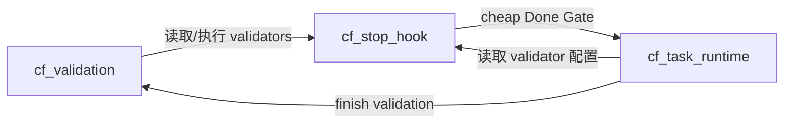

# code-flow 契约与代码收敛审计

日期：2026-10-26。扫描基线：HEAD `271b7c6` 加当前未提交修复；运行时源码聚合 SHA256：`13e8689dce708094b974e2f7e25c348d135ad2d04c19fb096d237836829b3217`。

## 结论

需要进行系统性收敛，优先减少同一事实的重复解释和跨层依赖。建议先统一 validator 执行、TASK 文档解析、运行时安装资源三个契约，再清理旧函数。现有模块全部有调用或正式入口证据，缺少批量删除模块的依据。

本轮产物是审计报告和临时扫描/复现数据。报告中的发现尚未作为新一轮运行时补丁实施；上一轮全仓校验通过不能证明这些跨入口分歧不存在。

## 范围与方法

- 全量结构扫描 `src/` 的 59 个 Python 模块、6 个 JavaScript 文件；Python 使用 AST 建立函数、导入和重复实现索引。
- 对 96 个测试代码文件和 64 份平台命令/技能文档扫描引用；部署副本不重复计为独立实现。
- 深读配置、TASK、Context、场景、验收证据、验证编排、安装迁移和平台入口的关键调用链。
- 用隔离临时项目复现配置错误、TASK 解析差异；实际 `npm pack` 后运行包内 CLI 初始化项目，检查安装结果。
- 对一次真实 `verify_plan` 做委托式读取计数和 cProfile 调用计数；测试收集真实执行。
- 依赖图包含函数内延迟导入，排除 `TYPE_CHECKING` 导入。依赖环表示模块相互依赖，不能据此推断当前启动会发生 ImportError。
- 结构扫描覆盖全部自有源码，语义深读集中于上述链路；本报告不宣称已证明所有输入组合和所有真实宿主都无缺陷。

临时证据位于 `/tmp/code-flow-system-audit-20261026/`：`scan.py`、`inventory.json`、`probes.py`、`probes.json`、`ignore-drift.json`、`packed-install-probe.json`。这些辅助脚本没有进入产品运行时。

## 规模与增长

| 基线 | Python 模块 | 物理行数 |
|---|---:|---:|
| `v0.8.0-rc.1` | 47 | 17,809 |
| `9d11d37` | 50 | 19,453 |
| `1410fcd` | 55 | 20,257 |
| `271b7c6` | 57 | 20,535 |
| 当前工作树 | 59 | 20,816 |

相对 RC，模块数增加 25.5%，行数增加 16.9%。当前 59 个模块中，26 个含主入口守卫，33 个是库模块；“scripts 目录文件数”不能等同于独立用户命令数。公开 runtime registry 有 37 个命令项，落在 16 个入口模块；Agent 命令目录有 11 个用户命令、4 个兼容别名、1 个内部维护命令。

其他量化结果：

| 指标 | 当前值 | 解释 |
|---|---:|---|
| Python 函数/方法 | 1,077 | 含嵌套 helper |
| 超过 50 物理行的函数 | 17 | 含签名、注释和文档，不等于 17 个严重缺陷 |
| 超过 100 行的函数 | 2 | 优先按责任和分支分析，避免仅改排版 |
| 跨模块导入内部符号 | 49 次 | 33 个不同符号，分布在 19 个消费者；包含 `_log` 等共享工具 |
| 测试导入内部符号 | 47 次 / 24 个文件 | 内部测试有价值，但不能替代公开流程验证 |
| 含延迟导入的依赖环 | 16 模块一组、3 模块一组 | 顶层直接导入图没有环 |
| 测试代码 | 96 文件 / 21,654 行 | 数量本身不能证明跨消费者契约一致 |
| 四平台命令/技能正文 | 64 文件 / 11,827 行 | 大量正文需要跨平台同步维护 |
| 本次 npm 包 | 170 文件；解压约 1.81 MB；压缩约 450 KB | 当前更突出的成本是维护和理解复杂度 |

最大的四个模块合计 6,031 行，占 Python 运行时约 29%：`cf_spec_context` 2,123 行、`cf_acceptance_runner` 1,492 行、`cf_task_workflow` 1,317 行、`cf_task_parallel` 1,099 行。模块增多的同时，主要编排责任仍然集中。

## 已确认的契约分歧

### A1 / P1：validator 配置错误在三个入口有不同结论

证据：[load_validators](../../../../../src/core/code-flow/scripts/cf_stop_hook.py#L79)、[validate_files](../../../../../src/core/code-flow/scripts/cf_validation.py#L61)、[finish validation](../src/core/code-flow/scripts/cf_task_runtime.py#L389)。

输入为存在但损坏的 `.code-flow/validation.yml`：`validators: [`。项目 enforcement 为 required，且存在本会话编辑事件。

| 消费者 | 实际结果 |
|---|---|
| `validate_files` | block，reason=no_validators_configured |
| `build_stop_result` | 空结果，Stop 放行 |
| `_run_finish_validation` | 空 issue，finish 的这一层放行 |

`load_validators` 把解析失败转换成空列表；不同消费者随后分别把空列表解释为阻断或可跳过。源错误被丢失，是重复解释产生分歧的直接例子。

建议：validator 配置读取与执行由现有 `cf_validation` 持有，Stop 和 finish 消费其结果。配置不存在、合法空配置、配置损坏应有明确区分。是否执行 heavy 是阶段策略，配置损坏不应被当作未配置。保持“无配置是否允许跳过”的既有产品策略单独可见。

### A2 / P1：TASK 文档存在多个解析器，读出的状态不同

证据：[workflow read_task_section](../src/core/code-flow/scripts/cf_workflow_service.py#L52)、[session _task_section](../../../../../src/core/code-flow/scripts/cf_spec_session.py#L30)、[index parser](../../../../../src/core/code-flow/scripts/cf_task_index.py#L37)、[gate parser](../../../../../src/core/code-flow/scripts/cf_spec_gate.py#L215)、[plan parser](../src/core/code-flow/scripts/cf_task_plan.py#L87)。

复现一：真实标题前有一行说明 `Example: ` 加行内代码 `## TASK-001: Sample`，后面才是真实的 `## TASK-001: Actual` 和 Status=done。workflow 使用字符串 find，读到示例并返回 draft；session 和 index 读到真实标题并返回 done。

复现二：输入有两个同名 TASK-001，前者 draft、后者 verified。workflow/session 取第一个，gate 的字典保留最后一个，index 同时保留两个。即使重复 ID 是非法输入，各入口也应一致拒绝，而不是各自选择。

建议：在现有纯任务解析层形成一个权威文档表示，统一标题边界、字段、重复 ID、围栏与缺失字段处理。各消费者读取该表示；状态更新仍由 workflow service 负责。选择 owner 时须避开 `cf_task_index` 与 `cf_task_plan` 已有依赖方向，不能再增加一个互相回调的包装层。

### A3 / P1：安装忽略列表有多份来源，源码安装与 npm 包不一致

证据：[源模板](../../../../../src/core/code-flow/.gitignore)、[CLI 内嵌列表](../../../../../src/cli.js#L596)、[Python 迁移列表](../src/core/code-flow/scripts/cf_spec_migrate.py#L430)。

真实打包和安装结果：npm 包不含源 `.gitignore`；包内 `node src/cli.js init --platform=codex` 成功，但生成的忽略列表缺少 `.stop.lock`、`.context-state.json`。源模板有 20 个条目，CLI 内嵌列表只有 18 个。这包含前几轮修复未同步完整的内容。

Python 迁移器还维护另一段内嵌列表。历史迁移可能有版本差异，需要明确目标版本；本轮已确认的是当前 CLI 与当前源模板的实际安装差异。依靠注释要求“三处同步”，无法建立当前版本的单一事实来源。

建议：先用小补丁补齐真实安装缺项，并用现有安装测试验证打包产物；随后单独做纯重构，由一份可打包声明生成/读取三处所需内容。用户自定义 ignore 内容仍由现有合并策略保护。

## 收敛热点与候选清理

### A4 / P2：基础层反向依赖编排层

有明确的三模块环：

另一个 16 模块强连通分量横跨 Context、Gate、场景、manifest、证据与 workflow。具体例子：`cf_acceptance_schema.validate_execution_baseline` 导入 manifest；manifest 的 CLI 又导入 plan quality；`cf_spec_context` 同时定义模型、锁、Git 范围和 CLI/doctor，并调用依赖它的 workflow service。`cf_evidence_store.compact_context_file` 也在存储模块内做 Context 文件编排。

建议先解除上图这个小环：把 validator 引擎归回现有 `cf_validation`，让 Hook 仅适配事件与反馈。大的 16 模块环需按数据模型、业务策略、编排入口逐条拆边，尚不适合承诺一次重排目录。仅把内部函数改成公开名字不能算依赖收敛。

### A5 / P2：旧 Spec 路径仍留在基础模块中

[cf_core.py](../src/core/code-flow/scripts/cf_core.py) 中 `read_matched_specs`、`read_specs` 未发现生产调用；`extract_context_tags` 只有测试调用。扫描也未发现通过 `getattr(cf_core, ...)` 或星号导入调用这些函数。三个函数合计 127 行，另有只服务于 tag 提取的词表和正则，合计约 200 行候选清理量。

当前注入已走 Context/path/Catalog 路由，这批旧代码仍让基础模块显得支持另一条注入路径。相关测试和导航说明也会让维护者误判其仍是生产契约。

建议先核对公开命令和平台入口覆盖，再删除这一组旧路径及专属测试/说明。该候选不包括仍被 router 使用的 `assemble_context`、仍被合规检查使用的 `match_domains`，也不包括正常使用的压缩函数。

`cf_task_state` 的 SCENARIO_STATUSES、CHECK_STATUSES 等常量和部分谓词只有测试引用；实际证据状态由 `cf_acceptance_evidence.STATES` 等解释。先明确哪些是有效契约，清除没有消费者的声明，避免把它们误当成已统一的 schema。保留被依赖解析等消费者使用的 FINISHED_STATUSES。

全量模块可达性初扫曾把 `cf_spec_migrate` 标成候选；人工核对确认它由 `src/migrate/spec-workflow.js` 调用，已排除。没有已证实可整文件删除的模块。

### A6 / P2：单次操作重复读取与解析

在真实 pytest 收集通过的一个两场景计划上，单次 `verify_plan`：

| 操作 | 次数 |
|---|---:|
| 读取 TASK 文本 | 4 |
| 读取场景源文本 | 3 |
| 读取 manifest | 2 |
| parse_scenarios | 2 |
| yaml.safe_load（包含 Context） | 4 |
| validate_scenarios / validate_checks | 各 3 |

这些数字来自同一次调用的计数，尚未外推为大型项目耗时。各 API 单独使用时保留校验是合理的；聚合入口可以加载一次，再把已验证的本次操作快照传给子步骤，减少重复 IO 和不同步骤看到不同文件版本的机会。

优先复用本次操作的数据，避免为这项优化再增加一套持久缓存、失效规则和清理脚本。优化前后需同时比较结果、漂移阻断和读取次数。

### A7 / P2：平台正文复制维护，生成器目前只生成示例

`src/adapters/commands.json` 已声明 Claude 为内容 canonical，但正文仍存于四个平台各 16 份文件。现有 [render-runtime-contract.js](../../../../../src/render-runtime-contract.js) 只生成命令示例，不能消除正文四处修改的成本。

建议后期复用现有生成流程，以一份正文和明确的绑定 token 规则生成其他平台文本。现有归一化 parity 测试应继续验证行为和内容。当前 0.8 的兼容别名有明确保留窗口，删除它们需要遵守该窗口。

### A8 / P2：少数大模块混合多种责任

`cf_spec_context` 同时有模型/序列化、active marker、Git 范围、文件写入、迁移恢复、应用决议、CLI、doctor；`cf_task_workflow` 导入 19 个内部模块；runner 的 `_select_profile` 单函数 122 行、包含 45 个分支类 AST 节点。

Node 侧也有责任集中：`src/cli.js` 共 1,212 行，其中 runInit 从第 772 行起覆盖约 340 行，负责核心部署、四平台安装、版本与输出；两个迁移器则通过子进程再次调用 CLI。其事务机制应保留，安装清单和平台差异应优先用声明数据收口。

这些是需要澄清 owner 的位置。建议先完成小范围契约收口，再按“能否减少反向依赖、重复判断和调用参数组合”决定结构调整。机械地满足函数行数或拆出更多文件不能作为收益证明。

## 契约 owner 建议

| 契约 | 建议权威位置 | 消费者应做什么 |
|---|---|---|
| TASK 标题、字段与唯一 ID | 现有纯任务解析层，确定一个 owner | 统一读取结构；投影、索引、Gate 使用同一结果 |
| TASK 状态推进 | cf_workflow_service | 通过状态迁移接口更新事实与视图 |
| Rule readiness / 合法延期 | cf_spec_gate 的共享判定，阶段策略显式传入 | finish、collect、review、doctor 复用判定并保留各阶段责任 |
| 场景/check 结构与 ID 关系 | cf_acceptance_schema | 入口验证一次；其他函数消费已验证记录 |
| 场景范围选择 | 现有 acceptance 范围层 | 明确 owner/profile/phase；不在消费者中重复推导 |
| 执行结果、证据完整性、当前输入新鲜度 | schema、evidence、check_inputs 分工明确 | 分别组合结构、执行、时效判定，避免一个宽泛 passed 代表所有条件 |
| validator 配置与执行 | cf_validation + cf_exec_base | Hook、finish、verify 消费同一执行结果 |
| 安装受管资源与 ignore 项 | 单一可打包声明 | CLI、迁移器、部署产物从声明派生 |
| 平台消息协议 | 各平台薄入口 | 保留各宿主协议，复用业务服务 |

“统一契约”指同一事实只有一个权威解释，并不要求把全部代码放进 `cf_core.py`，也不要求做一个通用 ContractManager。

## 分批实施顺序

| 批次 | 范围与目标 | 验证证据 |
|---|---|---|
| 1 | 修复 A3 打包安装缺项；行为修复与单一来源重构分开 | 真实 npm tarball fresh/upgrade、用户 ignore 保留、四平台安装 |
| 2 | A1+A4 小环：把 validator 执行归回现有模块；预计 3–4 个源模块 | 同一坏 YAML 在 validate/Stop/finish 的一致错误；heavy/预算原行为；3 模块环消失 |
| 3 | A2：统一 TASK 文档解析，先切 workflow/session，再切 index/gate/plan | 行内示例、围栏、重复 ID、缺字段、合法任务、真实 start→finish→collect/verify |
| 4 | A5：移除无生产调用的旧函数和独占词表，整理过期导航 | 公开 CLI/Hook 输出与路由结果；运行时代码净减少 |
| 5 | A6：本次操作快照复用；不增加持久状态 | 同一计划结果/漂移判断一致，读取与解析次数下降 |
| 6 | A7 与 A8：正文生成、剩余反向依赖和职责调整 | 平台 parity、打包产物、依赖图及真实需求完整流程 |

每个批次独立形成可审查差异；以明确的契约和可复现场景为边界。现有测试文件优先补充跨入口用例。临时扫描即可追踪指标，本轮不需要新增一个正式扫描命令或新的常驻门禁。

首轮收敛的评价指标是：三个已复现分歧消除、validator 小环解除、TASK 解析 owner 收口、旧路径清理、单次计划解析次数减少。脚本数可以辅助观察，但不设未经验证的“59 个必须砍到 30 个”目标。

## 已有结构中值得保留的部分

- `cf_exec_base.run_command` 已供业务检查共享 argv、deadline 和执行会话。
- `scenario_check_ids`、`check_outcome`、`recorded_check_hash` 已被多个证据消费者复用。
- 风险接受已集中在 `cf_acceptance_risk`，无需再做第二套风险模型。
- Codex/OpenCode 的原生入口已较薄，协议边界清楚。
- runtime 迁移已有 staging、备份、journal、互斥与回滚；收敛应沿用这些能力。
- 顶层导入图没有环，不应把延迟导入图中的所有环描述成当前启动故障。

## 全量模块索引

下表由结构扫描生成；行数为当前工作树物理行数，入/出度只计运行时内部模块，包含延迟导入。入口表示存在主入口守卫，库模块也可能由多个命令间接使用。

| 模块 | 行数 | 函数数 | 入度 | 出度 | 类型 |
|---|---:|---:|---:|---:|---|
| [cf_acceptance_evidence](../src/core/code-flow/scripts/cf_acceptance_evidence.py) | 324 | 13 | 7 | 4 | 库 |
| [cf_acceptance_manifest](../../../../../src/core/code-flow/scripts/cf_acceptance_manifest.py) | 926 | 35 | 8 | 7 | 入口 |
| [cf_acceptance_plan](../src/core/code-flow/scripts/cf_acceptance_plan.py) | 201 | 7 | 1 | 3 | 库 |
| [cf_acceptance_registration](../src/core/code-flow/scripts/cf_acceptance_registration.py) | 96 | 5 | 1 | 2 | 库 |
| [cf_acceptance_risk](../src/core/code-flow/scripts/cf_acceptance_risk.py) | 73 | 4 | 6 | 1 | 库 |
| [cf_acceptance_runner](../../../../../src/core/code-flow/scripts/cf_acceptance_runner.py) | 1492 | 79 | 2 | 7 | 入口 |
| [cf_acceptance_schema](../src/core/code-flow/scripts/cf_acceptance_schema.py) | 274 | 12 | 15 | 1 | 库 |
| [cf_audit](../../../../../src/core/code-flow/scripts/cf_audit.py) | 546 | 24 | 0 | 6 | 入口 |
| [cf_check_inputs](../src/core/code-flow/scripts/cf_check_inputs.py) | 157 | 9 | 6 | 0 | 库 |
| [cf_check_registration](../src/core/code-flow/scripts/cf_check_registration.py) | 273 | 15 | 3 | 3 | 库 |
| [cf_checks](../src/core/code-flow/scripts/cf_checks.py) | 336 | 13 | 6 | 1 | 库 |
| [cf_codex_hook](../../../../../src/core/code-flow/scripts/cf_codex_hook.py) | 98 | 3 | 0 | 10 | 入口 |
| [cf_context_cache](../src/core/code-flow/scripts/cf_context_cache.py) | 73 | 5 | 1 | 2 | 库 |
| [cf_core](../src/core/code-flow/scripts/cf_core.py) | 814 | 36 | 17 | 0 | 库 |
| [cf_design_lint](../../../../../src/core/code-flow/scripts/cf_design_lint.py) | 169 | 10 | 1 | 1 | 入口 |
| [cf_edit_service](../src/core/code-flow/scripts/cf_edit_service.py) | 149 | 10 | 4 | 5 | 库 |
| [cf_evidence_import](../../../../../src/core/code-flow/scripts/cf_evidence_import.py) | 604 | 35 | 0 | 5 | 入口 |
| [cf_evidence_store](../src/core/code-flow/scripts/cf_evidence_store.py) | 540 | 47 | 10 | 1 | 库 |
| [cf_exec_base](../src/core/code-flow/scripts/cf_exec_base.py) | 239 | 14 | 11 | 0 | 库 |
| [cf_feedback](../../../../../src/core/code-flow/scripts/cf_feedback.py) | 57 | 2 | 0 | 3 | 入口 |
| [cf_injection](../src/core/code-flow/scripts/cf_injection.py) | 112 | 9 | 6 | 2 | 库 |
| [cf_log](../src/core/code-flow/scripts/cf_log.py) | 159 | 8 | 9 | 0 | 库 |
| [cf_native_paths](../src/core/code-flow/scripts/cf_native_paths.py) | 26 | 2 | 3 | 1 | 库 |
| [cf_opencode_event](../../../../../src/core/code-flow/scripts/cf_opencode_event.py) | 102 | 4 | 0 | 10 | 入口 |
| [cf_patch](../src/core/code-flow/scripts/cf_patch.py) | 33 | 1 | 3 | 0 | 库 |
| [cf_plan_quality](../src/core/code-flow/scripts/cf_plan_quality.py) | 75 | 4 | 1 | 7 | 库 |
| [cf_post_hook](../../../../../src/core/code-flow/scripts/cf_post_hook.py) | 34 | 1 | 0 | 2 | 入口 |
| [cf_pre_tool_hook](../../../../../src/core/code-flow/scripts/cf_pre_tool_hook.py) | 45 | 1 | 0 | 4 | 入口 |
| [cf_rule_readiness](../src/core/code-flow/scripts/cf_rule_readiness.py) | 114 | 6 | 3 | 0 | 库 |
| [cf_runtime_install](../src/core/code-flow/scripts/cf_runtime_install.py) | 32 | 1 | 3 | 0 | 库 |
| [cf_scan](../src/core/code-flow/scripts/cf_scan.py) | 295 | 8 | 1 | 3 | 入口 |
| [cf_scenario_quality](../src/core/code-flow/scripts/cf_scenario_quality.py) | 149 | 9 | 2 | 0 | 库 |
| [cf_scenarios](../../../../../src/core/code-flow/scripts/cf_scenarios.py) | 350 | 19 | 5 | 2 | 入口 |
| [cf_session_state](../src/core/code-flow/scripts/cf_session_state.py) | 37 | 2 | 1 | 0 | 库 |
| [cf_spec_context](../../../../../src/core/code-flow/scripts/cf_spec_context.py) | 2123 | 105 | 16 | 7 | 入口 |
| [cf_spec_gate](../../../../../src/core/code-flow/scripts/cf_spec_gate.py) | 331 | 19 | 6 | 3 | 入口 |
| [cf_spec_metadata](../src/core/code-flow/scripts/cf_spec_metadata.py) | 387 | 23 | 6 | 0 | 库 |
| [cf_spec_migrate](../src/core/code-flow/scripts/cf_spec_migrate.py) | 541 | 38 | 0 | 3 | 入口 |
| [cf_spec_resolver](../src/core/code-flow/scripts/cf_spec_resolver.py) | 369 | 21 | 4 | 1 | 库 |
| [cf_spec_router](../src/core/code-flow/scripts/cf_spec_router.py) | 317 | 17 | 2 | 6 | 库 |
| [cf_spec_session](../../../../../src/core/code-flow/scripts/cf_spec_session.py) | 131 | 9 | 4 | 1 | 入口 |
| [cf_spec_verify](../src/core/code-flow/scripts/cf_spec_verify.py) | 651 | 36 | 2 | 5 | 库 |
| [cf_stats](../../../../../src/core/code-flow/scripts/cf_stats.py) | 538 | 28 | 0 | 9 | 入口 |
| [cf_stop_guard](../src/core/code-flow/scripts/cf_stop_guard.py) | 53 | 3 | 1 | 0 | 库 |
| [cf_stop_hook](../../../../../src/core/code-flow/scripts/cf_stop_hook.py) | 518 | 29 | 5 | 8 | 入口 |
| [cf_sync](../../../../../src/core/code-flow/scripts/cf_sync.py) | 148 | 8 | 0 | 0 | 入口 |
| [cf_task_index](../../../../../src/core/code-flow/scripts/cf_task_index.py) | 190 | 7 | 2 | 2 | 入口 |
| [cf_task_merge](../src/core/code-flow/scripts/cf_task_merge.py) | 629 | 43 | 1 | 1 | 库 |
| [cf_task_parallel](../../../../../src/core/code-flow/scripts/cf_task_parallel.py) | 1099 | 61 | 0 | 14 | 入口 |
| [cf_task_plan](../src/core/code-flow/scripts/cf_task_plan.py) | 250 | 11 | 1 | 0 | 入口 |
| [cf_task_runtime](../src/core/code-flow/scripts/cf_task_runtime.py) | 522 | 18 | 3 | 15 | 库 |
| [cf_task_state](../src/core/code-flow/scripts/cf_task_state.py) | 48 | 3 | 3 | 0 | 库 |
| [cf_task_workflow](../../../../../src/core/code-flow/scripts/cf_task_workflow.py) | 1317 | 56 | 1 | 19 | 入口 |
| [cf_traceability](../src/core/code-flow/scripts/cf_traceability.py) | 508 | 23 | 1 | 2 | 入口 |
| [cf_user_prompt_hook](../../../../../src/core/code-flow/scripts/cf_user_prompt_hook.py) | 156 | 8 | 2 | 6 | 入口 |
| [cf_validation](../../../../../src/core/code-flow/scripts/cf_validation.py) | 105 | 5 | 2 | 3 | 入口 |
| [cf_workflow_service](../src/core/code-flow/scripts/cf_workflow_service.py) | 532 | 28 | 4 | 7 | 库 |
| [cf_workflow_transaction](../src/core/code-flow/scripts/cf_workflow_transaction.py) | 96 | 6 | 3 | 1 | 库 |
| [cf_worktree_env](../src/core/code-flow/scripts/cf_worktree_env.py) | 253 | 19 | 1 | 0 | 库 |
