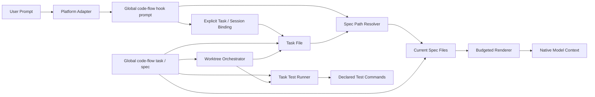

# code-flow v1.0 设计

> **状态**: v1 实现基线
> **日期**: 2026-11-10（2026-11-11 更新）
> **范围**: 文档主流程、运行时、数据格式、Hook、任务生命周期、worktree、分发方式
> **关系**: 取代 0.8.x 的运行时安装、Spec Context、Acceptance/Evidence 与阶段门禁架构；保留并改造 PRD/design/scenarios 主流程
> **原则**: 全局分发、不兼容、薄内核、显式定位、最新规范、主流程保留
> **说明**: 本文描述 v1 实现契约。PRD、design、scenarios 产物保留为项目可编辑资产，模板由工具维护，但旧 manifest/Stage Gate/E2E 门禁不复用。实现状态与测试覆盖见 [v1-implementation.md](v1-implementation.md)。

---

## 0. 摘要

v1.0 保留三条主线：

1. **文档主流程**：`cf-task:prd` → `cf-task:align` → `cf-task:plan`，产出一个需求的 PRD、前后端 design、scenarios 和一份多 TASK 的任务文档。
2. **Spec 自动注入**：确定当前任务后，把被选中的最新规范注入 AI 上下文。
3. **Task → Spec 沉淀**：任务完成后，把经过整理的稳定约束写回 specs，供后续适用任务使用。

任务测试、worktree 并行执行和基础文件写入保护服务于这三条主线。运行时安装清单、Spec Context、Acceptance Manifest、Evidence Store、阶段门禁、E2E 编排、质量闭环和统计审计退出核心。

### 关键决策

| 编号 | 决策 | 结果 |
|---|---|---|
| D1 | 运行时语言 | Node.js only，零 npm runtime 依赖，删除 Python/PyYAML |
| D2 | 分发方式 | 只支持全局安装；所有项目共享当前全局版本，接受统一升级 |
| D3 | 项目内 runtime | 不复制核心脚本；项目只保存用户数据和必要的平台适配入口 |
| D4 | 项目状态 | 任务状态在 Task，绑定和锁在系统临时目录；唯一持久编排例外是可见、gitignored 的 run ledger |
| D5 | 数据格式 | 一需求一份任务文档（多 TASK 段）；Spec 使用 JSON frontmatter；config 使用 JSON |
| D6 | Hook | 只有用户提交 prompt 这一业务触发；读取上下文，失败可降级，永不阻断 |
| D7 | 完成条件 | task finish 执行当前任务声明的测试；测试失败不写 done |
| D8 | 大测试集 | 精确声明相关测试，优先使用测试框架内置并行，独立命令显式并发 |
| D9 | Task → Spec | 稳定 Delta 身份、单调编号、原子写入、幂等重试；归档最后进行 |
| D10 | 旧版切换 | 人工保存资料、清理旧安装、重新 init；包内不保留兼容和一次性转换/清理脚本 |
| D11 | 精准注入 | 任务文档路径 + TASK ID 或显式会话绑定；Spec 用相对路径定位；不根据任务状态猜测 |
| D12 | 注入新鲜度 | 每次 prompt 重新读取选中规则；v1 不做跨 prompt 内容去重 |
| D13 | 文档主流程 | 保留 `cf-task:prd` → `cf-task:align` → `cf-task:plan`，作为独立入口和项目模板 |
| D14 | 模板资产 | 模板由 init 统一覆盖到 `.code-flow/templates/`；用户 specs/tasks 不覆盖，模板不参与 Spec 注入 |
| D15 | 场景定位 | `<需求>.scenarios.md` 是手工验收标准和设计追溯资产；不生成 manifest，不记录执行结果，不卡 finish/archive |
| D16 | worktree | 一任务一 worktree；Task 按三方归属合并；合并后聚合执行本批相关测试，通过后才 cleanup；Spec Delta 回协调工作区应用 |
| D17 | 用户命令面 | 只保留 prd / align / plan / start / archive + init / check / spec；finish/status/block/reopen/parallel 为 CLI 内部能力 |
| D18 | 健康检查 | 提供 `code-flow doctor` 和 `cf-check`，检查 Hook 入口、模板、config、Specs、Tasks 与 worktree run ledger |

先完成 Node 版本的可运行纵向闭环，再切换包入口并删除旧运行时。避免先改旧架构、再把同一行为重写一遍。

---

## 1. 背景与问题

### 1.1 当前代码确认的三个问题

1. **安装状态影响日常 Hook**  
   Codex/OpenCode 在业务事件前调用安装校验，读取清单并校验受管理文件。清单被 gitignore，新 worktree 缺少它时可能 block/deny。运行时是否部署完整与代码是否正确耦合。

2. **验收事实跨阶段耦合**  
   Plan/Start/Finish/Stop/Archive 消费 manifest、Spec Gate 或验收证据。当前 Finish 默认排除 E2E，Stop 使用 cheap 模式，Archive 调用 full 验证且可复用有效证据。问题是多阶段的条件、状态与恢复成本，不是每个阶段都会重跑全量 E2E。

3. **Task → Spec 缺少直接沉淀路径**  
   归档没有自动应用任务产出的稳定规则；独立 learn 与任务生命周期分离。注入依赖冻结的绑定 hash，规范更新会要求 refresh。

### 1.2 设计目标

| 目标 | 衡量方式 |
|---|---|
| 全局运行时 | 只需全局 npm 包，不依赖项目 node_modules、安装清单或 Python |
| 日常零阻断 | 无 edit/stop Hook；启动、解析和适配异常均不拒绝 prompt |
| 任务定位确定 | 显式路径优先，随后使用本会话绑定；歧义不选择其他任务 |
| 规范定位确定 | Spec 引用直接对应文件路径，不靠标签或自然语言猜测 |
| 最新规则 | 每次 prompt/start 读取当前选中 Spec，不冻结文件 hash |
| 完成测试可控 | 只跑任务声明的相关测试，实际执行且正确处理失败、超时和中断 |
| 沉淀可恢复 | Delta 部分成功后可重试，不重复分配 ID，不覆盖并发编辑 |
| 文档主流程保留 | PRD/design/scenarios/plan 仍有独立入口、项目模板和产物 |
| worktree 可并行 | 一任务一 worktree，支持 prepare/collect/merge/cleanup，Spec Delta 回主 worktree 应用 |
| 维护面小 | 核心约 3k LOC、约 15 个源文件作为预算；正确性和清晰职责优先 |
| 切换成本有限 | 少量用户手动切换一次，核心代码不承担历史格式处理 |

### 1.3 非目标与边界

- 不保证不同项目同时使用不同 code-flow 版本。
- 不读取或转换旧 YAML config/spec、旧 Task 字段格式及旧运行时状态；v1 任务文档使用新的多 TASK 段格式。
- 不做 E2E 编排、测试登记/收集、Evidence Store、审计或编辑期合规检查。
- 不根据 git diff 自动推断完整测试依赖，也不保证声明测试覆盖了全部需求。
- 不恢复旧 manifest/Spec Context/Stage Gate；worktree 编排只保留 prepare/collect/merge/cleanup 与隔离，不恢复 evidence sidecar。
- 不用测试结果证明之后发生的代码修改仍然正确。

---

## 2. 设计原则

1. **数据在项目，运行时在全局包**：项目保存 config、specs、tasks 与平台适配文件。
2. **任务状态与会话选择分开**：Task 保存生命周期；临时绑定只表达某个会话正在处理哪个任务。
3. **先定位，再读取，再渲染**：路径和显式引用决定范围；内容读取发生在每次注入时。
4. **Hook 可降级，写操作需严谨**：注入异常不拦截；无效写入、并发冲突和测试失败明确返回错误。
5. **测试执行尽量少而有效**：任务声明相关测试集合；框架负责内部并行；CLI 不额外全仓扫描。
6. **Spec 是规则事实源**：没有第二份冻结投影；规则被更新后，下次适用注入读取新内容。
7. **沉淀可以重复执行**：每个 Delta 有稳定身份，先应用规则，最后归档。
8. **旧版人工切换**：历史清理写在操作说明里，不进入 init 和运行时分支。
9. **文档主流程是一等公民**：PRD/design/scenarios/plan 仍是独立阶段和可编辑产物；删除的是 manifest/Stage Gate，不是文档流程。
10. **worktree 是执行层能力**：一任务一 worktree，代码和 Task 可并行；Spec 写入集中在主 worktree，避免跨分支规范冲突。

“唯一硬门禁”指任务完成的质量条件。参数、数据格式、合法状态和文件写入错误仍然必须拒绝对应 CLI 操作。

---

## 3. 总体架构

### 3.1 组件图



### 3.2 包与项目边界

```text
global npm package @michaelxwb/code-flow
  bin/code-flow.js
  lib/init.js
  lib/hook.js
  lib/task.js
  lib/taskdoc.js
  lib/spec.js
  lib/verify.js
  lib/config.js
  lib/frontmatter.js
  lib/render.js
  lib/glob.js
  lib/session.js
  lib/worktree.js
  lib/doctor.js
  lib/fs.js
  templates/
    config.json
    instructions.md
    workflow/prd.md
    workflow/design-lite.md
    workflow/design-full.md
    workflow/design-frontend.md
    workflow/scenarios.md
    workflow/task.md
    skills/cf-init.md
    skills/cf-check.md
    skills/cf-spec.md
    skills/cf-task-prd.md
    skills/cf-task-align.md
    skills/cf-task-plan.md
    skills/cf-task-start.md
    skills/cf-task-archive.md
    adapters/
    launcher/bridge.cjs
    launcher/hook.sh
    launcher/hook.cmd
    launcher/hook.ps1

user project
  .code-flow/
    config.json
    launcher/        # init/node 按当前 OS 生成；以下为可能产物
      bridge.cjs     # 所有 OS
      hook.sh        # POSIX；Windows 也生成以兼容 Git Bash
      hook.cmd       # Windows
      hook.ps1       # Windows PowerShell
    templates/
      prd.md
      design-lite.md
      design-full.md
      design-frontend.md
      scenarios.md
      task.md
    specs/shared/base.md
    specs/cli/runtime.md
    tasks/<date>/<requirement>/
      feature.prd.md
      feature.frontend.design.md
      feature.backend.design.md
      feature.scenarios.md
      feature.md              # 任务文档：多 TASK 段
  platform hook/config/skill files
```

单域需求可以只保留一个 design：`feature.design.md`；全栈需求前后端各一份。任务文档始终一份 `<requirement>.md`，内部包含多个 `## TASK-NNN` 段。

约束：

- Node >= 18，dependencies 为空，测试使用 node:test。
- 不依赖 Python、PyYAML、jq、ripgrep 或项目 node_modules。
- OpenCode 插件是必要的协议适配入口，只负责事件、进程调用与上下文交付，不包含核心规则逻辑。
- 模板、适配入口与用户数据不计入“核心脚本不复制”的运行时边界。
- `.code-flow/templates/` 是文档资产，不参与 Spec 注入；`.code-flow/specs/` 才是规则事实源。

### 3.3 全局分发与 Hook 启动

用户命令统一为：

```bash
npm i -g @michaelxwb/code-flow
code-flow init --platform=codex
code-flow task status
```

Hook 不经过 npx、npm exec 或项目 .bin 查找。init 写入稳定的项目适配入口：

```text
.code-flow/launcher/
  bridge.cjs    # 入口解析、限时子进程和原生协议校验；无 Task/Spec 业务逻辑
  hook.sh       # POSIX 外层守卫
  hook.cmd      # Windows CMD 外层守卫
  hook.ps1      # Windows PowerShell 外层守卫
```

所有平台共用 bridge 的解析策略，不能各自绕过它直接固定全局 JS 路径：

1. 从 PATH 解析第一个 `code-flow` 候选。拒绝当前仓库各工作区内的入口和项目 `node_modules/.bin`；不扫描全局安装目录、不调用包管理器。
2. 候选必须先通过不读取 Hook stdin 的 `code-flow hook capabilities --json` 探测。严格校验返回的包名 `@michaelxwb/code-flow`、支持的 `hook_protocol=1`、绝对 Node/JS 路径；核对入口实际所属 `package.json` 的 name/version/bin 与返回值一致，`codeFlow.hookProtocol` 声明也必须为 1（包级元信息，不是项目安装清单）。普通同名程序、旧版/不支持的协议、超时或损坏响应都视为不可用。该检查用于确定包和协议身份，不提供代码完整性认证。
3. PATH 候选不可用时，检查 init 固定的绝对 Node/JS 入口及相同包/协议身份。PATH 候选有效时优先使用它，支持 Node 管理器切换；两者均不可用时给出诊断并降级。
4. 选定后使用确定的 Node + JS argv 执行一次 `hook prompt --format=<platform>`。探测不消费 prompt；业务调用失败后不再次调用另一入口，避免已消费 stdin 的重复执行。
5. bridge 有界读取 stdin（最多 1MiB），有界缓冲 child stdout（最多 1MiB），成功且符合当前平台协议后才交付。非零退出、超时、输出超限或损坏 JSON 均丢弃 child stdout，向 stderr 诊断，返回空原生结果并退出 0。
6. 单个探测最多 800ms；探测阶段最多使用总预算的 800ms，至少保留 1200ms 给业务调用；探测与业务调用合计最多 2s，宿主 timeout 至少为 3s。探活耗尽时回退固定入口，不返回空上下文。超时回收子进程树。性能基准包含探测、bridge 与外层 shell 的全部成本。
7. PATH 选择结果按（PATH、固定入口、包版本、entry mtime）缓存 10 分钟；命中时仍重新校验包身份，过期、损坏或版本变化则重新探测。缓存 best-effort，写失败不影响启动。

`hook capabilities --json` 是无副作用的内部适配接口，不加载项目 config/Task/Spec。响应形状：

```json
{
  "package": "@michaelxwb/code-flow",
  "version": "1.0.0",
  "hook_protocol": 1,
  "node": "/absolute/node",
  "entry": "/absolute/global-package/bin/code-flow.js"
}
```

外层 shell 必须保留控制权，不能用 `exec` 替换自己。以下是 `hook.sh` 的**退出守卫片段**，不是完整启动器：`$@` 是已解析的 Node + `bridge.cjs` + format 参数；bridge 完成上述入口选择、限时和输出校验。原生包装器只缓冲并交付 bridge 正常退出的结果，bridge 在最后一次写 stdout 前完成协议校验；bridge 非零退出的部分输出也必须丢弃。

```sh
# code-flow:launcher-exit-guard
if [ "$#" -eq 0 ]; then
  printf 'code-flow launcher missing; run init again\n' >&2
elif code_flow_output=$("$@"); then
  if [ -n "$code_flow_output" ]; then
    printf '%s\n' "$code_flow_output"
  fi
else
  printf 'code-flow launcher failed; run doctor\n' >&2
fi
exit 0
```

- shell 优先选择可用的 PATH Node，回退 init 固定的 Node；两者均缺失时不启动 bridge，诊断后退出 0。CMD/PowerShell 必须有同等的外层异常和退出码保护。
- bridge 本身启动失败时，原生适配层丢弃未完成输出；无可用 Node 时允许无 stdout。正常 bridge 的 no-op 输出为空原生结果。
- 路径、空格、引号、Windows `.cmd`/`.ps1` 分别处理；探测 `.cmd` 的 quoting 和实际 Node/JS 调用分别测试。
- 启动器是 init 托管的薄适配资产；不包含规则选择、任务状态或学习逻辑，不复制核心 runtime。
- 同路径的全局升级直接更新核心行为；更换全局前缀后 PATH 可恢复解析，固定入口失效由 doctor 提示重新 init。
- 不记录项目安装版本清单，不验证安装文件 hash。全局包缺失时允许本轮缺少注入。

---

## 4. 数据模型

### 4.1 config.json

```json
{
  "version": 1,
  "workflow": "hook",
  "always": ["shared/base"],
  "budget": {
    "maxTokens": 2500,
    "maxBytes": 16384
  },
  "tests": {
    "timeoutSeconds": 120,
    "jobs": 2,
    "regression": null
  },
  "capture": {
    "enabled": false,
    "path": ".code-flow/process"
  },
  "paths": {
    "src/**/*.js": ["cli/runtime"],
    "src/components/**": ["frontend/components"]
  }
}
```

| 字段 | 必填 | 说明 |
|---|---|---|
| version | 是 | 数据格式版本，固定 1；不是全局包版本 |
| workflow | 否 | hook（默认，Spec 注入 + 最小 Task 文档/测试）或 full（另走 PRD/design/scenarios）；设计文档是项目资产，不作为 prompt 输入 |
| capture | 否 | 可选过程采集：enabled 为 literal boolean，path 是 .code-flow 下的相对目录；默认关闭 |
| always | 否 | 始终注入的 Spec/Rule 引用；默认 []，建议只放少量项目基础规则 |
| budget.maxTokens | 否 | 估算预算，默认 2500；不是模型 tokenizer 的精确上限 |
| budget.maxBytes | 否 | 渲染文本 UTF-8 硬字节上限，默认 16384 |
| tests.timeoutSeconds | 否 | 单条命令默认超时，默认 120 |
| tests.jobs | 否 | 可并行命令的并发上限，默认 2；必须为正整数 |
| tests.regression | 否 | 可选的独立回归命令，argv/run 二选一，可带 timeout/cwd/parallel/group/env；只在 task parallel merge 的任务测试之后执行一次。未配置或 null 时不执行，工具不猜命令 |
| paths | 否 | 具体文件路径的 glob → Spec/Rule 引用列表 |

init 的初始 always 和 paths 均为空；上例表示已整理好 Spec 的项目配置。所有字段均做类型和取值校验。

不包含 quality_loop、spec_workflow、tags/tier 路由、active task 或持久测试缓存。

### 4.2 Spec 文件与身份

Spec 身份由相对 .code-flow/specs/ 的路径去掉 .md 得到：

```text
.code-flow/specs/cli/runtime.md
→ cli/runtime

cli/runtime#RULE-001
→ 上述文件中的 RULE-001
```

不设置独立 id，不维护 ID→文件索引。Spec 路径使用小写字母、数字、短横线、下划线和目录分隔符；拒绝空段、绝对路径、.. 和项目外符号链接。路径大小写按契约严格匹配。

文件示例：

````markdown
---
{"description":"CLI 与 Hook 运行时约束","next_rule":3}
---
# CLI Runtime

## Rules

- [RULE-001] Hook 注入读取当前规范，不执行安装清单校验。
  所有异常只影响本次注入，诊断写 stderr。

- [RULE-002] Hook stdout 只输出平台协议 JSON。
  示例中的日志与错误文本不得混入 stdout。
````

规则契约：

- frontmatter 必须是 JSON object；description 非空，next_rule 为正整数。
- 新规则默认生成 RULE-001 这类数字 ID；也接受 RULE-cli-hook-protocol-001 这类已有语义 ID。
- Rule ID 在同一 Spec 内唯一、保持稳定。完整引用包含 Spec 路径，不能跨文件只使用裸 Rule ID。
- 新增编号来自 next_rule，分配后递增；删除不回退计数。不能从当前最大编号推导历史分配状态。
- 规则块从顶层 `- [RULE-...]` 开始，包含后续缩进说明、空行和代码示例，直到下一个顶层规则或章节。
- 解析器识别代码围栏，围栏内的规则样例不作为真实规则。
- 没有 Rules 的 Markdown 仅作说明或导航，不提供规则；重复 Rule ID 使该 Spec 无效。
- 改名 Spec 文件需要同时更新 config/Task 的路径引用；v1 不做自动 impact 或别名兼容。

### 4.3 Task 文档

路径：

```text
.code-flow/tasks/<date>/<requirement>/<requirement>.md
```

一个需求只有一份任务文档，内部包含多个 `## TASK-NNN` 段；不再为每个 Task 建单独文件。设计文档前后端分开：`<requirement>.frontend.design.md` / `<requirement>.backend.design.md`，单域可用 `<requirement>.design.md`。

````markdown
---
{"version":1,"requirement":"feature"}
---
# Tasks: feature

## TASK-001: 简化 Hook 启动

- **Status**: draft
- **Depends**:
- **Source**: feature.backend.design.md#5.2 Hook 启动
- **Scenarios**: S-01, E-01
- **Spec-Refs**: cli/runtime
- **Paths**: src/hooks/**, tests/hooks/**
- **E2E**: ci:e2e

### Tests

```json
[
  {
    "id": "hook-unit",
    "argv": ["node", "--test", "tests/hooks/prompt.test.js"],
    "timeout": 120,
    "parallel": true
  }
]
```

### Description

实现全局运行时的 prompt 注入入口。

### Checklist

- [ ] 完成平台启动和故障降级。
- [ ] 执行声明的相关测试。

### Spec Delta

```json
[
  {
    "id": "DELTA-001",
    "op": "add",
    "target": "cli/runtime",
    "rule": "Hook 适配入口优先选择已验证的 PATH 全局包，回退固定 Node/JS，失败不阻断 prompt。",
    "evidence": "移除包管理器启动开销，并避免项目本地版本遮蔽全局版本。"
  }
]
```

### Log

- [2026-11-10] created

### Verification

- 2026-11-10T10:45:00Z PASS commands=1/1 executed=1 deduped=0 elapsed=0.8s

## TASK-002: Prompt 状态展示

- **Status**: draft
- **Depends**: TASK-001
- **Source**: feature.frontend.design.md#4.1 Prompt 状态
- **Scenarios**: S-02
- **Spec-Refs**: frontend/components

### Tests

```json
[
  {"id": "component", "argv": ["npm", "run", "test:component"]}
]
```

### Description

...
````

Task 文档字段：

| 字段 | 位置 | 必填 | 说明 |
|---|---|---|---|
| version | 文件 frontmatter | 是 | 任务文档格式版本，固定 1 |
| requirement | 文件 frontmatter | 是 | 需求名，与目录/文件名一致 |
| id | `## TASK-NNN:` 标题 | 是 | TASK-NNN，文档内唯一 |
| status | TASK 段落 bullet | 是 | draft / in-progress / done / blocked |
| depends | TASK 段落 bullet | 否 | 依赖的 TASK ID 列表；用于批次分层和 worktree merge 顺序 |
| source | TASK 段落 bullet | 否 | design/scenarios 的章节引用；用于人工追溯，不参与状态门禁 |
| scenarios | TASK 段落 bullet | 否 | 本任务负责的 S-/E-/B- 场景 ID；作为手工验收标准，不生成 manifest |
| spec_refs | TASK 段落 bullet | 否 | Spec 路径或路径#Rule ID；推荐 Spec 级引用以接收后续新增规则 |
| paths | TASK 段落 bullet | 否 | 预期修改范围与人工说明；不用于猜任务或把 glob 当文件路径映射 |
| tests | `### Tests` JSON | 是 | 测试命令数组；每项有唯一 id，argv/run 二选一 |
| skip_tests | TASK 段落 bullet | 否 | tests=[] 时允许免测，必须为 true 且同时有非空 skip_reason |
| skip_reason | TASK 段落 bullet | 否 | 免测理由；可执行配置、Hook 和运行时代码变更应声明相应测试 |
| e2e | TASK 段落 bullet | 否 | ci:<job> 或本地命令字符串；finish/archive 不主动执行 |
| spec_delta | `### Spec Delta` JSON | 否 | 可显式应用的规范增量，见 §8 |

完整任务身份是：

```text
.code-flow/tasks/<date>/<requirement>/<requirement>.md#TASK-001
```

CLI 使用：

```bash
code-flow task start <requirement>.md --task TASK-001
code-flow task finish <requirement>.md --task TASK-001
code-flow task archive <requirement-dir>
```

裸 `TASK-001` 只用于展示，跨需求定位必须带任务文档路径；同一需求内由文档内唯一性保证。

### 4.4 状态转移

| 操作 | 来源 | 结果 |
|---|---|---|
| start | draft / blocked | in-progress，输出最新 brief，可绑定当前会话 |
| start | in-progress | 幂等，重新输出最新 brief，可绑定当前会话 |
| start | done | 返回状态错误，使用 reopen |
| block | in-progress | blocked，记录必填 reason |
| reopen | done | in-progress，记录必填 reason，历史 Verification 保留 |
| finish | in-progress | tests 全部通过后 done；失败或中断保持 in-progress |
| finish | 其他状态 | 返回状态错误，不执行测试 |
| archive | 需求中全部 Task 为 done | 应用 Delta 后移动整个需求目录 |

只有四个生命周期状态。done 表示此次声明测试通过或显式免测；不表示代码以后未变，不代表需求全量/E2E 通过。

### 4.5 持久数据与瞬时状态

项目不生成旧版安装清单、active marker、Spec Context、acceptance manifest、会话日志、结果缓存或会话投影。唯一持久编排状态例外是 §7.10 的 run ledger；不能再将整个产品表述为“无持久运行时状态”。

允许的临时状态按两种身份隔离：

```text
os.tmpdir()/code-flow/workspaces/<workspace-key>/
  sessions/<session-token>.json
  locks/<resource-key>.lock
os.tmpdir()/code-flow/repos/<repository-key>/
  locks/coordinator.lock
  locks/groups/<group-key>.lock
```

| 状态/锁 | 身份与作用域 |
|---|---|
| 会话绑定、Task 段锁、任务文档短写锁 | workspace-key = SHA-256(工作区真实根路径)；不同 worktree 分离 |
| 编排协调锁、测试 group 锁 | repository-key = SHA-256(realpath(git common dir))；同仓库所有 worktree 和独立 CLI 调用共享 |
| 非 Git 项目的测试 group 锁 | repository-key 回退到工作区真实根路径的 SHA-256 |

- 会话绑定保存 task 文档的项目相对路径、TASK ID 和最近绑定时间；不保存规范正文或测试证据。
- session-token 由平台、工作区路径和原生 session ID 确定，使用 SHA-256 的 64 个十六进制字符；CLI 严格校验格式，拒绝把原生 ID 直接用作文件名。
- 绑定丢失后回退到显式任务文档路径 + TASK ID/具体文件路径/catalog，不猜测其他任务；重新 start 可恢复绑定。
- 同一 token 同时只能有一个任务；切换必须显式 start。缺少原生 session ID 时不用 pid 伪造会话身份。
- Hook 读路径不等待测试、group 或写锁。所有锁记录 pid、进程启动身份和随机 owner token；仅在确认原拥有进程已退出后回收，不能只凭文件年龄或可复用 pid 删除。
- Task 写入使用“段操作锁 + 短文档写锁”，见 §7.2；测试期间不持有整份文档写锁。group 锁持有到进程树确认结束。
- 同一需求的 archive/learn 与 Task 写入按固定顺序协调：仓库协调锁（仅编排/归档/学习）→ 需求锁 → 按 TASK ID 排序的段锁 → Spec 写锁/短文档写锁；不得持有文档写锁等待测试、group 或其他段锁。
- 原子替换使用目标目录的短暂临时文件并及时清除；崩溃残留不作为事实源。

run ledger 位于 `.code-flow/worktrees/<run-id>/run.json`，可由 status/doctor 查看，随 `worktrees/` gitignore。它记录编排意图、提交与恢复进度，不充当可跨次复用的测试缓存，不被 prompt Hook 读取。Spec 内 Applied Deltas 与 Task 内 Verification 属于用户文档产物。

---

## 5. 稳定、精准的 Spec 注入

### 5.1 触发与输入

| 时机 | 行为 |
|---|---|
| 用户提交 prompt | 解析任务/具体路径，读取选中的最新规则，按平台协议交付 |
| task start | 设置任务状态，输出同一套最新 brief，可写本会话绑定 |
| 编辑文件 | 无 Hook |
| Stop | 无 Hook |

平台输入标准化为 root、platform、session_id、prompt。根目录由事件 cwd 或 OpenCode 会话 location.directory 向上定位有效 config.json；拒绝使用其他 worktree 的工作目录。

prompt 路径提取沿用明确的 @path、引号、反引号和裸文件路径语法；忽略 URL、harness 通知、日志块及项目外路径。代码围栏和引用块中的任务指令不参与任务选择。

### 5.2 任务选择：显式路径 → 本会话绑定 → 无任务模式

显式任务指令只识别独立行：

```text
task: .code-flow/tasks/2026-11-10/hook-runtime/hook-runtime.md#TASK-001
```

| 顺序 | 条件 | 行为 |
|---|---|---|
| 1 | prompt 有一个合法 task: 任务文档路径 + TASK ID | 只在本轮使用该任务，不自动改绑定 |
| 2 | 无显式 task:，且有本会话绑定 | 直接读取绑定的任务文档 + TASK ID；必须存在、格式有效且为 in-progress |
| 3 | 没有绑定 | 无任务模式，使用具体文件路径映射 |
| 异常 | 显式任务不存在、出现多个 task:、绑定无效或已结束 | 输出定位诊断，使用 always + 明确文件路径；不回退到其他任务 |

不扫描所有任务文档，不选“唯一 in-progress”，不使用裸 TASK ID、路径相似度、关键词或标签推断任务。需要寻找任务时使用 task status，输出任务文档路径 + TASK ID。

Hook 在协议上下文中提供当前 session-token；cf-task skill 将其原样传入：

```bash
code-flow task start .code-flow/tasks/2026-11-10/hook-runtime/hook-runtime.md --task TASK-001 --session <token>
```

- --session 缺省时仅启动并打印 brief，不修改其他会话选择。
- cf-task skill 负责发现任务、读取 Hook 给出的 token 并完成一次绑定；用户不需要在之后的每条 prompt 中重复写任务文档路径 + TASK ID。
- 会话绑定必须由显式 CLI 操作创建；Hook 不修改绑定。
- task unbind --session <token> 主动结束会话任务选择。
- Task done/blocked/归档后旧绑定自然失效，Hook 不沿用该任务；其他会话不被批量改写。
- 临时绑定是“当前会话选择”的指针，不承载阶段门禁、Spec hash 或任务完成事实。

### 5.3 规则集合与路径映射

```text
selected =
  config.always
  ∪ selected_task.spec_refs
  ∪ config.paths[explicit_concrete_prompt_files]
```

- 每条引用直接定位对应 Spec 文件；不扫描全量 Spec 建立 ID 索引。
- Spec 路径引用选取该文件的全部有效规则；#Rule 引用只选该规则。
- 同一完整 Rule 引用只输出一次，保留全部选择来源。
- Task.paths 是 glob 声明，不代入另一个 glob 做字符串匹配。
- 新文件尚不存在时仍可按规范化的具体路径匹配；不要求读取源码。
- 多个 paths 模式同时匹配时取并集。没有自然语言相似度和隐式标签路由。
- 找不到文件/规则只诊断该引用，其他有效引用继续注入。
- 规则内容的语义冲突由编写/学习时审查，运行时不擅自决定优先覆盖。

glob 只支持 *、**、? 与 /。* 不跨目录，** 可匹配零层或多层目录；src/**/*.js 必须匹配 src/app.js。不支持 brace/extglob 等扩展，遇到不支持的模式必须诊断。路径统一为项目相对 POSIX 形式，拒绝 .. 逃逸，严格区分大小写。

### 5.4 无任务模式与 catalog

- 有具体文件路径：注入 always + 命中路径的规则。
- 没有任务且无路径命中：注入 always，并输出有限的 Spec catalog。
- catalog 只输出 Spec 路径、description 和读取方式；只读头信息，不提供规则数。需要准确规则数时显式调用 `spec list`，由查询路径解析正文，不新增计数缓存。
- catalog 默认最多列 20 项，其余给总数与 spec list 命令；不假装已经注入 catalog 对应规则。
- 历史 Task 数量不影响 Hook 任务定位；task status 的显式目录扫描属于人工查询路径。

### 5.5 渲染、预算与缺失可见性

```markdown
## Spec Constraints (latest)

session: <token>
task: .code-flow/tasks/2026-11-10/hook-runtime/hook-runtime.md#TASK-001
workflow: hook

### cli/runtime
source: .code-flow/specs/cli/runtime.md
selected-by: task.spec_refs

- [RULE-001] Hook 注入读取当前规范，不执行安装清单校验。
  所有异常只影响本次注入，诊断写 stderr。

omitted: cli/runtime#RULE-002
read-more: code-flow spec inject --task-file <task-file> --task TASK-001 --full
```

- 预算优先级：always → Task 明确引用的单条规则 → Task Spec 级规则 → prompt 路径规则。
- 同优先级保持配置/Task 引用顺序，文件内保持规则顺序，输出可重复。
- 以完整规则块为裁剪单位；规则太大时整块省略，不能截掉限定条件或代码围栏。
- 同一 Spec 的连续规则共用一个 `###`/source/selected-by 头部，减少每轮注入的重复字节。
- token 估算按 ASCII 约四字符一 token、非 ASCII 保守逐字符计数，并明确标为估算；同时强制 maxBytes。
- 为任务身份、来源、诊断和 omitted 摘要预留预算；omitted 列表有上限，超出只显示数量与完整读取命令。
- --json 返回完整 selected/omitted 引用及诊断；Hook 只发送预算内文本。
- 一个规则也放不下时始终输出精简的预算诊断与读取路径（即使诊断本身超出预算），不返回空上下文。
- task start 和 Hook 使用同一 Renderer；spec inject --full 显式绕过展示预算。

### 5.6 最新内容与沉淀可见性

- 每次 prompt/start 直接读取选中的 Spec 当前内容，不使用冻结 hash。
- v1 不做跨 prompt 内容去重，避免规范改动或上下文压缩后被旧缓存抑制。
- Task Spec 级引用会自动看到该 Spec 新增规则；单 Rule 引用只读取该 Rule 的最新版本。
- archive 的新增规则在下一次选择到该 Spec 且预算允许时可见；省略的规则必须出现在 omitted。
- 规范在同一个 agent turn 内改变时，下次 prompt/start 才更新，不增加编辑期事件。
- 临时会话绑定不会冻结 spec_refs；每次同时重读 Task 当前声明。

### 5.7 读路径错误

| 情况 | Hook 行为 |
|---|---|
| config 缺失 | 项目外静默 no-op |
| config 无效 | stderr 诊断，本轮不注入，不猜另一份配置 |
| task 无效/歧义 | 放弃本轮任务选择，保留 always/明确文件路径注入 |
| Spec 无效或引用不存在 | 诊断对应来源，继续其他有效规则 |
| session ID 缺失 | 关闭会话绑定定位，显式路径仍可工作 |
| 空 prompt | 静默 no-op |
| 平台输入损坏或内部异常 | stderr 诊断，返回空协议结果并正常结束 |

读路径可降级；start/finish/learn/archive 等写操作对无效 config、Task 或待写 Spec 返回明确错误，不以空配置写回数据。

---

## 6. Hook 与平台适配

### 6.1 一个业务触发，多种原生交付

Claude/Costrict/Codex 使用 UserPromptSubmit。OpenCode 使用 prompt 回调准备数据、context 回调交付内容，二者属于同一次 prompt 注入链路。

不注册 PreToolUse、PostToolUse、Stop、tool.before、tool.after 或 session.idle，也不在其他事件运行检查。

### 6.2 协议

```bash
code-flow hook prompt --format=claude
code-flow hook prompt --format=costrict
code-flow hook prompt --format=codex
code-flow hook prompt --format=opencode
```

Claude/Costrict/Codex：

```json
{
  "hookSpecificOutput": {
    "hookEventName": "UserPromptSubmit",
    "additionalContext": "..."
  }
}
```

OpenCode 进程返回：

```json
{"context":"..."}
```

- stdout 只输出相应协议 JSON，空输入/no-op 可无输出。
- stderr 保存简短诊断；无 decision、reason、permissionDecision 或 permissionDecisionReason。
- 全部适配层错误路径都返回正常结果，不能把 child process 失败转成 prompt 回调 reject。
- CLI 内设置截止时间并及时结束，平台 timeout 留出启动与交付余量；超时不要求用户修复任务才能继续。

### 6.3 OpenCode 交付与隔离

- 从原生会话读取 sessionID 与 location.directory，不用父会话目录替代子会话/worktree。
- prompt 回调等待本次 CLI 结果，按 sessionID 暂存 context。
- context 回调消费对应会话结果并加入原生 system/context 容器。
- 当前请求失败只记录诊断并继续；不把其他会话的待交付内容取过来。
- 插件实例保留少量内存缓冲，销毁时清理，不写项目会话文件。
- 插件通过 §3.3 的项目 bridge 使用同一套 PATH 校验、固定入口回退、限时和协议校验；用确定的 Node + bridge argv 调用 execFile，Windows 不依赖 `.cmd` 运行核心。不得绕过 bridge 固定调用旧全局 JS。

### 6.4 Codex 与系统启动器

- 合并 .codex/hooks.json 和所需的 features.hooks 配置，保留用户其他设置。
- features.hooks 只自动维护两种形式：规范 `[features]` 表 + `hooks = true`，或根级单行 `features.hooks = true`。引号键、引号形式的 features 表、inline table、`[[features]]`、多行值和重复表返回 `config_format`，并提示手工改成规范形式；不再猜测边角 TOML。
- 项目配置层和变更的 Hook 定义需要符合宿主的加载/信任要求；init 显示宿主要求的后续操作，不代替宿主授权。
- Claude/Costrict 使用其原生 settings 格式；启动器按相应 shell 做存在性守卫和失败降级。
- POSIX 与 Windows 分别测试退出码、路径引号、入口丢失和进程超时。
- 运行环境缺少 Node 时由外层启动器降级；业务 try/catch 不能覆盖尚未启动的进程。

### 6.5 性能目标

- 已绑定或显式指定任务时，IO 与选中 Task/Spec 数量相关，不随历史 Task/Spec 总量增长。
- 不调用包管理器，不校验全量安装文件，不全仓哈希，不启动 Python。
- 端到端测量从平台启动器启动到可解析 JSON 输出完成；OpenCode 额外记录 context 交付耗时。
- 参考基准为 500 个 Spec、5000 个历史 Task、1 个任务引用 3 个 Spec：热启动 p50 < 100ms、p95 < 200ms。
- 冷启动单独报告，不与热启动混合；catalog 全量导航查询单独测量，不能拿它替代命中任务的快路径。
- 基准需记录 OS、Node 版本、硬件、样本数量和读取文件数量；目标不保证任意磁盘/机器达到相同耗时。

---

## 7. Task 生命周期与快速验证

### 7.1 task start

1. 校验任务文档路径、TASK ID、格式及允许状态。
2. 读取 always + task.spec_refs，输出最新 brief；不解析 task.paths 的 glob 交集。
3. draft/blocked 原子改为 in-progress 并追加 Log；已 in-progress 保持状态。
4. --session 存在时写本工作区、本会话的临时绑定（任务文档 + TASK ID）；不存在则只输出 brief。
5. 绑定写入失败时明确报告“任务已启动，绑定未建立”，可重新 start 重试。
6. 不执行测试，不检查 manifest/Context/安装清单，不要求其他任务全部停止。

### 7.2 task finish

1. 仅允许 in-progress，取得 `(任务文档路径, TASK ID)` 的段操作锁；同一 TASK 的 start/block/reopen/finish 串行，不同 TASK 可同时执行测试。
2. 校验测试声明，保存该 TASK 段原文及共享 frontmatter/标题结构；不预先扫描全仓测试和源码，不持有整份文档写锁。
3. 使用 §7.6 调度器真实执行声明命令。失败、超时、启动错误或中断时停止排队并回收进程树；正常失败退出 1，中断保留平台中断状态。
4. 收集结果后短暂取得任务文档写锁，**重新读取最新整份文件**。校验选中段及共享结构与开始时一致，只在最新文本中替换本 TASK 段，原样保留其他 TASK 的修改。
5. 全部命令成功且比较通过才写 done + Verification；普通测试失败可在比较通过时追加失败 Verification，但保持 in-progress。写回使用同目录原子替换，并在替换前核对最新全文未再次变化。
6. 所属 TASK 段或共享结构被改动时，不写状态、日志或 Verification，明确报告 `task_concurrent_change`；测试输出仍返回调用方。其他 TASK 的正常变化不构成冲突，也不能被旧全文覆盖。
7. tests=[] 只在 skip_tests=true 且 skip_reason 非空时允许 done，记录 skipped。
8. 释放文档写锁与段操作锁。start/block/reopen 等所有 Task 写入口复用相同的“段锁 → 最新全文 → 只补本段”写入器。
9. 不主动执行 e2e，不计算 Spec/代码快照，不保存可复用测试缓存。

finish 的通过事实限定为此次声明命令成功。done 任务要重新验证时必须先 `task reopen --reason <text>`，再 finish；不能直接 finish done。分支集成后的相关测试由 §7.10.6 的内部合并验证执行，不重复改写各 Task 的状态。

✅ TASK-001、TASK-002 同时 finish：测试可重叠；各自取得短写锁后读取最新文档，最终两段状态和 Verification 均保留。  
❌ 每个 finish 保存测试开始时的整份文档，测试后直接覆盖；后完成的任务抹掉先完成任务的结果。

### 7.3 task archive

1. 读取给定需求目录中的任务文档 `<requirement>.md`；没有 TASK 段或 TASK 无效时返回错误，不能以空集合通过。
2. 按 §7.10.7 确定 Git 注册的协调工作区身份，拒绝所有受管理 worker；不能只判断路径包含 `.code-flow/worktrees/`。存在未完成的关联 run 时，先完成合并与集成验证。非 Git 项目可直接使用当前项目根。
3. 全部 Task 必须 done；获取需求与待写 Spec 所需的瞬时锁。
4. 生成 Delta 计划，校验全部目标与前置条件，再按 §8 应用；--no-learn 显式跳过学习。
5. 全部可应用项完成后，移动目录到 .code-flow/tasks/archived/<original-date>/<requirement>。
6. 目标已存在时返回冲突并保留源目录，不自动重命名需求身份。
7. 输出归档路径和每个 Delta 的 applied/already-applied/duplicate/skipped 结果。
8. 不执行任何任务测试，不跑 E2E、全量测试或 acceptance。
9. 不解析 scenarios、不检查场景状态；手工验收由人按 `<需求>.scenarios.md` 负责。
10. --dry-run 只读取和预览，包含预计 Rule ID、文本 diff 与失败原因，不分配编号、不写锁/缓存/绑定。

部分成功后的重试规则见 §8.3。归档不宣称重新验证了当前工作区。

### 7.4 task status、block、reopen 与 unbind（CLI 内部）

这些是内部状态操作，不作为独立用户命令暴露：

- status [requirement-dir] 扫描任务文档，输出任务文档路径、TASK ID、状态、测试命令数、Spec 引用、scenarios、最近 Verification；`cf-check` 和 skill 可调用。
- block <task-file> --task TASK-001 --reason <text> 记录阻塞原因并设 blocked，不运行测试；由 skill 在用户明确暂停时调用。
- reopen <task-file> --task TASK-001 --reason <text> 恢复 done 任务为 in-progress，保留历史验证记录；由 skill 在用户明确重开时调用。
- unbind --session <token> 只移除本会话选择，不改变 Task 状态；重复执行幂等。

### 7.5 不提供独立 verify 入口

- `task finish` 是改变 Task 完成状态时执行测试的唯一入口；通过即 done，失败保持 in-progress。`task parallel merge` 在集成代码上内部执行相关测试并记录 run 结果，不调用 finish，不新增 verify 命令。
- 不提供 `task verify` 用户命令，避免“先 verify 再 finish”重复执行。
- E2E 和全量回归由 CI 执行；`e2e` 字段只做声明，不在本地 finish/archive 主动运行。
- `tests` 只应声明快速 unit/integration；工具不从命令字符串猜测试类型；若用户把 E2E 写进 `tests`，它会按声明执行，责任在任务声明。

### 7.6 测试执行契约

每条测试：

| 字段 | 说明 |
|---|---|
| id | Task 内唯一的测试命令 ID，用于日志和结果对应 |
| argv / run | 必须二选一；argv 直接启动，run 按平台 shell 执行 |
| cwd | 默认项目根；realpath 校验在工作区内，拒绝目录/符号链接逃逸 |
| timeout | 正数，秒；默认 tests.timeoutSeconds |
| parallel | 默认 false；只有 true 才允许与其他命令重叠执行 |
| group | 可选共享资源名称；按 repository-key 跨 CLI 调用、跨 worktree 互斥，不限制框架内部 workers |
| env | 可选字符串键值对象；参与去重，不允许覆盖编排器保留的 CF_* 身份/隔离变量 |

执行保证：

- 优先 argv；需要管道、环境变量或 npm shell script 时显式使用 run。
- 非 parallel 命令是独占屏障，按声明顺序执行；前后的并发批次都必须先收敛。
- parallel 命令以 tests.jobs 或 --jobs 控制单 runner 的进程数；group 在 §4.5 的仓库共享锁上互斥，不能只维护单次调用的内存 Set。先取得 group 再占用执行槽，取消时立即退出等待；等待最多该命令 timeout 秒，超时记 `lock-timeout`，运行超时从 spawn 后另计。锁在进程树完全结束后才释放。不同仓库的同名 group 不共享锁，跨仓库共用外部资源需另行隔离。
- 禁止按机器核数无上限创建进程。worktree 编排默认同时最多 2 个 worker，可用 `prepare --workers <n>` 调整；受管命令并发上限为 workers × jobs，CPU/内存预算还需乘上框架配置的 workers。框架线程数无法从任意命令可靠推断，必须在任务命令中显式限制并在测量中报告，不承诺自动约束框架内部进程。
- 超时和中断回收整个进程树；POSIX 使用进程组，Windows 使用树终止机制，并设置结束宽限与最终回收。
- 分别记录 exit code、signal、timeout、spawn-error、cancelled 和未执行；只有正常退出 0 为 PASS。
- stdout/stderr 持续消费，分别限制最多 64KiB 且只保留尾部 50 行；不先缓存完整输出。
- 相同调用内对完全相同的 argv/run、cwd、timeout、实际执行环境与调度约束去重，不跨 finish/merge 或会话复用结果。集成验证的 cwd 均解析到协调工作区，按 §7.10.6 合并重复命令。
- Hook 永不执行测试命令。

### 7.7 大测试集的速度策略

速度主要来自少执行无关测试、减少解释器/测试框架启动次数，以及使用已有测试框架的 workers：

1. cf-task 计划时声明相关模块与直接回归测试；不默认把全仓测试挂到每个 Task。
2. 同框架的相关测试文件合成一次命令，让框架内部并行、共享发现/启动成本。
3. 彼此独立的不同测试命令才标记 parallel=true；数据库、端口和共享 fixture 用 group 约束。
4. 全量回归和 E2E 放到 CI/release；在对应仓库提供独立 CI 命令示例，不让 archive 再调用。
5. CLI 只收集本任务命令，不做全仓测试登记/收集、源码哈希或隐式依赖图构建。
6. 输出调度等待、进程启动、实际运行、执行/去重数量，定位慢在工具还是测试本身。

不会为了速度采信上次通过。CLI 不能保证任意大型测试集瞬间执行，但必须避免自身引入无关扫描、重复启动和重复运行。

### 7.8 Verification 记录

```text
### Verification

- 2026-11-10T10:45:00Z PASS commands=2/2 executed=2 deduped=0 elapsed=1.8s tests=9f2c1a7b3d4e head=4c1f0a9b2d3e dirty=0
  - hook-unit PASS exit=0 duration=0.8s
  - hook-integration PASS exit=0 duration=1.2s
- 2026-11-10T11:02:10Z FAIL commands=1/2 executed=1 cancelled=1 elapsed=0.6s tests=9f2c1a7b3d4e head=4c1f0a9b2d3e dirty=1 tests-changed
  - hook-unit FAIL exit=1 duration=0.6s
  - hook-integration CANCELLED
```

这里的数量是命令数量，不虚构框架内部 test case 通过数。记录写入 Task，不建立集中 Evidence Store。

`tests` 是 start 时测试声明的规范化哈希；声明在 start 后被修改时追加 `tests-changed`。`head`/`dirty` 描述实际被测试的树：`head=none` 表示非 Git 项目，`dirty=1` 表示测试跑在未提交的业务改动上（`.code-flow` 文档改动不计入）。这些字段用于追溯，不改变 PASS/FAIL 语义，也不构成额外门禁。

### 7.9 场景文档与手工验收

`cf-task:align` 继续产出 `<需求>.scenarios.md`，作为设计、计划、实现和人工验收的共同参照。

场景字段建议：

| 字段 | 说明 |
|---|---|
| id | S-/E-/B- 编号是人工约定；工具只要求单行非空，不校验格式 |
| title | 场景标题 |
| level | unit / component / contract / integration / system / e2e / manual |
| boundary | 关键真实边界；manual 场景写清人工步骤 |
| expected | 可观察的预期结果 |
| exec | manual / local / ci；e2e 可写 `ci:<job>` |
| owner | 负责任务或人工验收人 |

约束：

- 场景是**手工执行标准和追溯资产**，不生成 acceptance manifest。
- `cf-task:plan` 把场景映射到 Task 的 `source` / `scenarios` 字段，不生成 check 注册表。
- `task finish` 只跑 Task 的 `tests`，不解析 scenarios，不做 scenario quality 门禁。
- `task archive` 不检查场景执行状态，不跑 E2E，不把场景未执行作为归档阻断。
- `manual` 场景只作为测试人员的补充验收参考；工具不记录人工验收结果，不写 manual evidence。
- `e2e` 场景可以写本地命令或 `ci:<job>`；本地 `finish`/`archive` 不主动执行，CI 独立负责。
- 场景与 design 的引用关系保持可追溯，但不恢复 manifest/Stage Gate。

### 7.10 Worktree 并行编排

v1 保留 prepare/collect/merge/cleanup 与并行隔离，删除 evidence/manifest/Spec Context 耦合。下文“协调工作区”指 Git 注册的主工作区，身份定义见 §7.10.7；不要求分支名为 main。

### 7.10.1 用户入口与批次

用户只说“开始执行 TASK-001”或“开始执行批次一的任务”，由 `cf-task:start` 处理：

- 单任务：任务文档路径 + TASK ID，调用 task start；
- 批次：任务文档 + 批次号/任务列表，内部 prepare → 派发 worker → start/finish → collect → merge 与集成验证 → cleanup；
- 按 Depends 拓扑分层；当前可执行层的依赖必须已 done，并且在本 run 之外的依赖代码已进入协调分支；
- 循环依赖、缺失依赖、重复 TASK ID 报错；“批次一”为当前第 1 个可执行层，层内按 TASK 声明顺序合并；
- 后续依赖层在上一层合并、集成验证通过后，从新的协调 HEAD 创建 worktree，不能从旧 baseline 执行尚未合入的依赖。

`task parallel prepare/status/collect/merge/cleanup` 只作为内部 CLI。prepare 默认同时运行 2 个 worker，`--workers <n>` 为正整数；ledger 记录上限，skill 的派发和受管 runner 必须遵守。

### 7.10.2 编排与 collect 契约

1. 一 TASK 一分支、一 worktree；对应关系写入 ledger。prepare 在协调锁内核对所有未结束 run，禁止两个 worker 认领同一完整 Task 身份。
2. worker 只修改业务代码和任务文档中自己所属 TASK 段；不修改共享 frontmatter、其他 TASK、config、Specs、其他需求文档或托管适配资产。Spec Delta 只记录在本段。
3. collect 通过 Git 注册信息核对实际 worktree 根、分支、仓库 common dir、记录的 base_head；分支 HEAD 必须是 base_head 的后代且包含本任务提交。拒绝路径冒名、分支切换、HEAD 重写和只创建空提交却没有本段完成记录的情况。
4. 审查 `base_head..HEAD` 的全部 diff，不能只看最后一次提交。Specs/config/其他 TASK/共享结构/托管资产有改动时，返回 `worktree_scope_violation`。Task.Paths 仍是说明，不把它擅自当作业务代码全量白名单。
5. 所属 TASK 必须 done；保存 `collected_head` 与该 TASK 段的 SHA-256。merge 前重新核对两者与工作区状态，collect 后新增提交或编辑必须重新 collect，不能合并未检查的新 HEAD。
6. 工作区必须没有待提交业务改动。自动 init 的精确工具增量按 §7.10.4 单独识别；只有内容仍与 ledger 记录完全一致时才能作为工具资产例外，不能忽略整个 `.claude/`、`.agents/`、AGENTS.md 等目录或文件。
7. 批次全部 collect 成功后，按拓扑/声明顺序向协调分支做 `--no-ff` 合并；只按 §7.10.5 解决任务文档归属，普通代码冲突停止并保留 Git 合并现场。
8. Git 无冲突只表示文本可以合并。所有分支合入后必须执行 §7.10.6 的相关测试；工具不声称能自动识别全部代码语义冲突。
9. 只有集成验证通过且协调 HEAD 未变化才自动 cleanup。失败、冲突或未知恢复状态均保留 worktree、分支和 ledger，不自动 reset、回滚、push 或删除。
10. worker 内 `task archive` 与 `spec learn` 都拒绝；Spec 写入只在协调工作区、关联 run 完成后执行，见 §7.10.7。

✅ collect 核对整个分支 diff 与被收集的准确 SHA，merge 使用该 SHA。  
❌ 只检查“有提交 + done + clean”，把 worker 修改其他 TASK 或 Spec 的提交一起合入。

### 7.10.3 run ledger 与恢复

`.code-flow/worktrees/<run-id>/run.json` 是显式允许的持久编排台账，随 `worktrees/` gitignore。下面是两个 worker 已准备完成时的快照；SHA/绝对路径示意为字符串占位值：

```json
{
  "version": 1,
  "run_id": "20261110-120000-abc123",
  "coordinator": {
    "root": "/work/project",
    "git_common_dir": "/work/project/.git",
    "repository_key": "<sha256>",
    "branch": "refs/heads/main",
    "initial_head": "<git sha before baseline>"
  },
  "base_head": "<git sha after baseline>",
  "task_file": ".code-flow/tasks/2026-11-10/feature/feature.md",
  "baseline_specs_sha256": "<sha256 of specs paths and content>",
  "platforms": ["claude"],
  "workers": 2,
  "jobs": 2,
  "status": "running",
  "created_at": "2026-11-10T12:00:00Z",
  "updated_at": "2026-11-10T12:01:00Z",
  "operation": null,
  "worktrees": [
    {
      "task": "TASK-001",
      "path": ".code-flow/worktrees/20261110-120000-abc123/TASK-001",
      "branch": "cf-task/20261110-120000-abc123/TASK-001",
      "base_head": "<git sha after baseline>",
      "status": "prepared",
      "collected_head": null,
      "collected_task_sha256": null,
      "env": {
        "CF_WORKTREE_ID": "20261110-120000-abc123/TASK-001",
        "CF_TASK_ID": "TASK-001",
        "CF_RUN_ID": "20261110-120000-abc123"
      },
      "init_changes": [],
      "error": null
    },
    {
      "task": "TASK-002",
      "path": ".code-flow/worktrees/20261110-120000-abc123/TASK-002",
      "branch": "cf-task/20261110-120000-abc123/TASK-002",
      "base_head": "<git sha after baseline>",
      "status": "prepared",
      "collected_head": null,
      "collected_task_sha256": null,
      "env": {
        "CF_WORKTREE_ID": "20261110-120000-abc123/TASK-002",
        "CF_TASK_ID": "TASK-002",
        "CF_RUN_ID": "20261110-120000-abc123"
      },
      "init_changes": [],
      "error": null
    }
  ],
  "merge": {
    "order": ["TASK-001", "TASK-002"],
    "steps": [],
    "conflicts": []
  },
  "integration": {
    "status": "not-run",
    "tested_head": null,
    "env": {
      "CF_WORKTREE_ID": "20261110-120000-abc123/integration",
      "CF_TASK_ID": "",
      "CF_TASK_IDS": "TASK-001,TASK-002",
      "CF_RUN_ID": "20261110-120000-abc123"
    },
    "commands": [],
    "error": null
  },
  "cleanup": {
    "steps": [],
    "kept": []
  }
}
```

核心字段契约：

| 字段 | 约束 |
|---|---|
| status | preparing / running / merging / verifying / cleaning / done / blocked / aborted；done 需集成验证和 cleanup 完成 |
| worktrees[].status | planned / created / prepared / running / collected / merged / removed / blocked |
| operation | 空闲为 null；变更前写入 kind、task（如适用）、expected_head、collected_head（如适用）和目标路径，完成后补 result_head/结果再清除 |
| merge.steps[] | task、collected_head、status；正常 merge 另记 before_head、after_head。恢复按 collected_head 的祖先关系补记，不要求唯一定位 merge commit |
| integration | not-run / running / passed / skipped / failed / invalidated；保存统一批次 env、tested_head、实际命令/去重归属、耗时和失败原因 |
| cleanup.steps[] | task、path、branch、collected_head；按 planned → worktree-removed → branch-deleted 记录，逐步可重试 |
| init_changes[] | 仅此 worker 自动 init 的 path、是否 tracked、before/after SHA-256 与托管范围；用于区分精确工具增量，非通用安装清单 |

- prepare/collect/merge/cleanup 取得 repository-key 的协调锁；同仓库不同 run 的变更不能并发。worker 执行与 Hook 不持有此锁。
- ledger 使用严格 schema、原子替换和原文比较；每次不可逆 Git/文件操作**先记意图，再执行，再记结果**，并校验 Git 的实际状态，不能只信 ledger 或路径存在。
- `status`/`doctor` 只读展示观测结果与恢复建议；恢复由再次调用对应 prepare/merge/cleanup 显式执行，不在查询时写 ledger。

必须覆盖的恢复窗口：

| 中断窗口 | 恢复判定与动作 |
|---|---|
| baseline commit 已创建，ledger 结果未落盘 | 依据意图中的旧 HEAD、精确提交范围和实际父提交核对；唯一匹配才采用新 HEAD，否则 blocked，不再次盲目 commit |
| 分支/worktree 只建了一部分，或某个平台 init 失败 | 核对 Git 注册路径、分支和 base_head；仅补缺失步骤。存在同名但身份不符的资源时 blocked，不接管、不删除 |
| merge commit 成功，ledger 尚未更新 | 若 collected_head 已是 HEAD 祖先，补记 recovered；不重复 merge，不要求唯一定位 merge commit |
| Git 仍在合并或代码冲突未解 | 校验 MERGE_HEAD 与预期 collected_head、当前分支和 HEAD；保持现场，等待解决后继续；不自动 abort/reset |
| 测试中断或 tested_head 与当前 HEAD 不同 | 结果为 failed/invalidated；下次 merge 重新执行全部本批相关命令，不复用旧 PASS |
| worktree 已移除但分支未删 | 同时检查 Git 注册和文件路径；确认分支 tip 仍是已合入的 collected_head 后仅删对应分支 |
| 协调分支被切换/重写、路径被移动、历史无法唯一对应 | blocked 并给出实际/预期身份；不凭“文件还在”继续，也不自动修正所有权 |

### 7.10.4 Baseline、自动 init 与环境

prepare 要从协调工作区的实际快照创建 worker：

1. 校验非 bare Git 仓库、已检出的协调分支，以及 `.code-flow/worktrees/` 已被 gitignore。预检所有资源名和 Task，再写 ledger 意图。
2. 允许自动提交的范围**仅**为 `.code-flow/specs/`、当前需求目录和 `.code-flow/config.json`。其他任何未提交业务改动都拒绝，包括 `.code-flow/` 内的其他需求；暂存区中的无关改动也拒绝，不能顺带 commit。忽略文件不自动纳入提交。
3. 用精确路径形成 baseline commit；没有变化则复用 HEAD。`--no-auto-baseline` 要求上述范围也已干净，复用现有 HEAD；不修改用户提交、不 push。
4. 记录提交前/后 HEAD 与 `baseline_specs_sha256`。Spec tree hash 按规范化路径排序并包含文件路径及内容；拒绝符号链接/忽略 Spec 导致的不完整快照。
5. 从记录的 baseline 创建 worker，验证实际 base_head、Task 文档和 Specs 快照一致。
6. 默认不初始化 worker：worker 通过全局 CLI 工作。只有需要在 worker 内启动宿主会话时，才用 `--init` 检测已安装平台并执行 `init --platform=<platform>`。init 只写模板、启动器、命令和自身托管配置/指令段，不覆盖 config/specs/tasks。
7. 将每个 init 的精确变更范围及前后内容指纹写入本 worker 的 init_changes。它们留在本地供宿主加载，**不提交到任务分支、不作为业务合并内容**；若 agent 已提交它们，collect 拒绝。混合文件中的任何额外用户改动也不能作为工具增量豁免。
8. 显式 `--init` 时，任一平台初始化失败会让 run 进入 blocked，不派发该 worker；保留已完成资源供 prepare 重试。不 init 只跳过工具入口安装，不跳过 baseline/身份校验。
9. 根据 ledger 派发 worker。每次 start/finish 与内部 runner 都从 Git 身份匹配的 ledger 重建 env，而非仅在首次启动 agent 时 export。已有 shell 的 CF_* 身份/隔离值必须与本次 worker 或集成环境一致，否则拒绝，不允许串任务。

环境隔离：

- 必填 `CF_WORKTREE_ID`、`CF_TASK_ID`、`CF_RUN_ID`；需要固定端口/数据库隔离时，prepare 一次性分配 `CF_PORT_OFFSET` / `CF_DB_SUFFIX` 并持久到 ledger，所有重试沿用。
- runner 将这些保留值加入每个子进程；`tests[].env` 不能覆盖。测试自身必须消费隔离变量；未隔离的共享资源使用 §7.6 的仓库级 group 锁。
- 不自动根据变量重写业务配置，不声称变量存在就已完成隔离。并行预算记录 workers × jobs × 框架 workers，优先使用框架内部并行。
- 关联 ledger 通过 Git 注册信息和完整 worktree 映射定位；查不到或不唯一则写操作报错，不以路径名称或可伪造 env 单独确认身份。

协调工作区的 Specs 在批次中不自动同步到 worker。每次 merge 前比较当前 Specs 与 baseline hash，不一致就停止；未完成 run 期间 CLI 学习被拒绝，手工修改同样会被 hash 检查发现。

### 7.10.5 任务文档的三方合并

以协调 HEAD 与 collected_head 的实际 Git merge-base 文档为 B（首次通常为 base_head，修复后可为此前已合入的 collected_head），协调分支已累计文档为 M，该 worker 的 collected_head 文档为 W。merge-base 必须在已记录的分支祖先链上且唯一，歧义时停止。先校验文档 frontmatter、TASK 集合/顺序和完整性，再按 TASK 身份处理：

- worker 所属 TASK 以外的段必须满足 W=B；结果原样保留 M，包含其他任务或人已经作出的修改。
- worker 所属段：M=B 时采用 W；W=B 时保留 M；M=W 时使用该共同内容。
- 两侧都偏离 B 且 M≠W 时返回 `task_merge_conflict`，保留冲突现场；不按状态高低、不做 checklist/Log/Verification 的无条件并集。
- frontmatter、TASK 增删/重排等共享结构若偏离 B，不能按所属段自动吞并；要求人工协调后重新 collect。
- Tests、Spec-Refs、Depends、Source、Scenarios、Delta 和 Status 是有含义的任务内容，不能拼接成新的未经验证声明。

✅ TASK-001 分支只改自己的段：保留 M 中已完成的 TASK-002，替换 TASK-001；主分支明确 reopen 与 worker 的 done 相遇时报告冲突。  
❌ “done 优先”把明确重开的 in-progress 覆盖回 done；把两份 Tests/Delta 直接取并集后继续宣称测试已通过。

### 7.10.6 合并后的相关测试

1. 全部已收集 SHA 按顺序合入后，在协调工作区运行本 run 所有 TASK 的 `tests` 并集；使用同一个 runner，不调用 task finish，不改变各段 Status/Verification。
2. 只收集明确声明的相关 unit/integration 命令，不做全仓发现，不隐式执行 e2e、scenarios 或 CI。按 TASK/命令声明顺序规划，在协调工作区重新解析 cwd；argv/run、timeout、有效 env、parallel/group 完全一致才去重，结果映射回所有来源 TASK。若 config.tests.regression 声明了项目级回归命令，在同一 runner、同一批次环境下追加执行一次；未配置则跳过，工具不猜命令。
3. 这些测试针对合并代码真实重跑，不复用 worker PASS。使用 ledger.integration.env 的统一批次环境：CF_WORKTREE_ID=<run>/integration、CF_RUN_ID=<run>、CF_TASK_ID 为空、CF_TASK_IDS 为本批 ID 列表；需要时另分配稳定的集成端口/数据库后缀，不复用尚在运行的 worker 资源。任务身份只作来源归属；命令需要单 TASK 业务参数时在 `tests[].env` 显式声明，差异 env 不去重，不能为提速忽略实际环境差异。全部免测时保留每个任务的 skip_reason，integration 标记 skipped，不伪造 PASS。
4. 开始前记录 `tested_head`，要求工作区无待提交业务改动；运行后重新核对协调分支、HEAD、业务状态和声明未变化。测试生成了未忽略业务文件或 HEAD 改变时结果 invalidated，不允许 cleanup。
5. 结果写在 ledger.integration，包含实际执行、去重、未执行、耗时及错误。测试失败/超时/中断时 run=blocked，保留已合并提交与所有 worker；不自动撤回代码，也不把 done 任务改回 in-progress。
6. 修复后重新 collect（相关 worker 若有变化）并再次 merge；已经合入的准确 SHA 不重复合并，但全部本批相关命令仍真实重跑。协调分支上的修复提交也需已提交、通过身份/范围检查，并记录新的 tested_head。
7. 仅当前协调 HEAD 等于已通过/显式免测的 tested_head、无待处理冲突、声明未变时，run 才进入 cleaning。cleanup 前再核对一次；测试结果不作为之后其他 run 的缓存。

✅ 两个分支分别通过，Git 文本合并也成功，但合并后相关测试失败：停止后续自动动作，保留分支和测试输出。  
❌ 将“git merge 无冲突”解释为“无语义冲突”，直接删除各 worker 与分支。

### 7.10.7 协调工作区与写入权限

- Git 项目的协调工作区是 `git worktree list --porcelain` 注册的主工作区，其 realpath 与 git common dir 构成身份；prepare 捕获分支完整 ref，后续操作必须与 ledger 一致，不能根据分支名 main 或路径前缀猜测。
- 所有受管理 worker，即使被移动到 `.code-flow/worktrees/` 外，`task archive`、`spec learn` 仍返回 `coordinator_required`。普通 linked worktree 同样不作为 Spec 写入/归档协调点；非 Git 项目以当前真实项目根为协调点。
- `.git` 存在但 Git 身份无法读取时返回数据错误，不降级为非 Git 来绕过限制。ledger 的路径与 Git 注册不一致时停止并要求显式修复。
- 未结束 run 包括 preparing/running/merging/verifying/cleaning/blocked；aborted 必须来自显式放弃并已核对资源处置，不能由超时自动推断。关联需求存在未结束 run 时拒绝 archive；存在可能影响 Specs 的未结束 run 时拒绝 learn。run 完成后 archive/learn 可共享同一应用器；`--no-learn` 不绕过 archive 的身份/未完成 run 校验。
- archive/learn 在仓库协调锁内检查身份和 run 状态，并持有到本次 Spec 写入/归档结束，避免与 prepare 的状态检查竞态；锁顺序遵守 §4.5。
- 所有权与范围检查由 collect/merge/CLI 写入口负责；不能只依赖 worker prompt 中的约定。直接手工编辑的 Spec 仍由 merge 前快照校验发现。
- 默认 cleanup 仅删除本 ledger 准确拥有、已合并且通过集成验证的 worker/分支；删除前核对实际 branch tip、Git 注册和 init 增量。只恢复/移除内容仍与 init_changes 完全一致的工具增量，用户新增改动不删除。
- `cleanup --force` 是显式放弃失败 run 的工作成果：报告未合并提交/未提交改动后才删除指定 run 的资源；仍不能绕过所有权检查、删除协调工作区或影响其他 run，正常 skill 流程不使用它。

### 7.10.8 旧版实现参考

参考旧 Git 基线中的 `cf_task_parallel.py`、`cf_task_index.py`、`cf_task_merge.py`、`cf_worktree_env.py` 和 `cf-task/start.md`：复用 prepare/collect/merge/cleanup、命名、Depends 与按段归属思路，使用 Node 重写。

- 删除旧 context/manifest/evidence 合并和 Spec refresh/Stage Gate；不移植“done 优先”的状态覆盖策略。
- 自动安装改为项目薄启动器 + `init --platform`；不复制 Python/runtime 清单。
- 旧 batch smoke 不复用；§7.10.6 是直接复用当前 Task.tests 的有界集成验证，没有独立测试登记或持久 PASS 缓存。
- baseline 明确包含 specs/当前需求/config，其余脏业务内容拒绝；共享资源锁改为仓库级身份，工作区会话仍分离。

---

## 8. Task → Spec 闭环与写入一致性

### 8.1 Delta 模型

Delta 位于对应 TASK 段的 `### Spec Delta` JSON 块，值必须直接是数组；不接受 `{ "spec_delta": [...] }` 包装，也不是文件级共享数组。

```json
[
  {
    "id": "DELTA-001",
    "op": "add",
    "target": "cli/runtime",
    "rule": "Hook 适配入口优先选择已验证的 PATH 全局包，回退固定 Node/JS，失败不阻断 prompt。",
    "evidence": "移除包管理器启动开销，并避免项目本地版本遮蔽全局版本。"
  },
  {
    "id": "DELTA-002",
    "op": "update",
    "target": "cli/runtime",
    "ref": "RULE-001",
    "before": "Hook 注入读取当前规范，不执行安装清单校验。\n所有异常只影响本次注入，诊断写 stderr。",
    "rule": "Hook 只读当前被选中的规范，失败时输出诊断并继续 prompt。",
    "evidence": "明确故障降级的交付边界。"
  }
]
```

- id 在同一 Task 内唯一，创建后保持稳定；完整 Delta 身份为任务文档相对路径 + `#TASK-ID` + `#DELTA-ID`。
- op 支持 add/update/remove；target 是 Spec 路径。
- add 要求 rule/evidence 非空；update 另需 ref/before；remove 要求 ref/before/evidence，不需要 rule。
- before 是旧规则完整内容，含续行和示例；匹配时只统一换行和移除规则容器缩进，不折叠内部空白或忽略大小写。
- update 保留 Rule ID；remove 删除有效规则，历史编号不复用。
- 相同 Delta ID 已应用后，不允许换 payload 再应用；修订时新增 Delta ID。

### 8.2 校验与预览

- finish 校验 Delta 结构，无效项诊断但不改变测试的通过结果，不写 Spec。
- learn/archive 先识别相同身份的已应用记录：payload 一致则直接跳过，不再要求旧 before 匹配更新后的规则；payload 不一致则冲突。随后才校验未应用 Delta 的目标文件、目标规则及 before；无效项导致本次学习失败。
- 缺失 target 不静默跳过；提示先创建目标 Spec，或 archive --no-learn 显式放弃本次应用。
- --dry-run 展示新增/修改/删除 diff、预计规则分配、重复项和冲突，只读且无副作用；不预留编号，实际执行需重新读取并规划。
- 文本重复只统一换行并裁剪外围空白；不做语义去重，不忽略代码大小写和有意义的内部空格。
- cf-spec skill 在准备 Delta 时审查作用域、稳定性、可执行示例和现有规则冲突；运行时不声称完成自然语言语义审查。

### 8.3 分配、写入和幂等重试

1. 取得工作区写锁，读取本次全部 Spec，先核对已应用记录，再在内存副本按任务文档 + TASK ID + Delta 声明顺序预演未应用操作与 before，全部预检通过后才写入。
2. 若 next_rule 指向已用或已退休数字 ID，返回数据错误；不重新从最大存量编号推导。
3. add 分配 next_rule 并递增；duplicate 关联已有 Rule，不消耗编号。
4. 同一 Spec 的规则、next_rule 和本次应用记录组成一次完整文件替换。
5. 写入使用同目录临时文件、flush/fsync 与 rename；替换前比较原始内容，发现变化就返回并发冲突。
6. 多 Spec 按路径排序逐个提交，不承诺跨文件全有或全无。已成功文件保留，失败时需求目录不移动。
7. 重试以完整 Delta 身份和规范化 payload SHA-256 判断：相同已应用项跳过，payload 改动返回冲突，未应用项继续。
8. 全部成功后再移动需求目录。移动失败同样保留已写 Spec，下次重试不会重复分配规则。
9. Task 在规划到归档之间被修改时不移动目录，重新预检；不覆盖用户编辑。

Spec 自身保存简短应用记录，作为用户产物的一部分：

```markdown
## Applied Deltas

- {"source":"2026-11-10/hook-runtime/hook-runtime.md#TASK-001#DELTA-001","op":"add","rule":"RULE-003","payload_sha256":"<sha256>","at":"2026-11-10T10:45:00Z"}
```

- 记录行使用 JSON object；解析器按 JSON 读取，不使用 `key: value;` 文本格式。
- 记录不参与规则注入；用于重试、provenance 和追踪已删除编号。
- duplicate/update/remove 同样记录对应身份与目标 Rule。
- payload hash 只用于显式写操作，不是 Hook 的 Spec 绑定快照。
- archive 目标使用原始日期与需求名；归档 Task 保留原始身份供追踪，归档目录不参与新的 learn 写操作。
- Spec 学习不另建运行时 journal；恢复依赖 Spec 内应用记录与尚未移动的 Task。worktree 编排的 ledger 是 §4.5 明确允许的独立例外。
- 瞬时锁失效后仍保留每个成功 Spec 的完整内容，不能出现 next_rule 已改、规则未写的半个文件。

### 8.4 spec learn

```bash
code-flow spec learn --from-task <task-file> --task TASK-001 --dry-run
code-flow spec learn --from-task <task-file> --task TASK-001
```

- 只允许未归档且 done 的 Task，必须同时提供任务文档和 `--task TASK-NNN`；按 §7.10.7 校验协调工作区与未完成 run，worker 中即使显式调用也拒绝。已应用 ID 的修订必须使用新 Delta ID。
- archive 调用同一个应用器，不维护第二套规则编号或写入逻辑。
- 应用结果逐项输出 applied/already-applied/duplicate/error，不用一句“已学习”掩盖未应用项。
- --no-learn 仅属于 archive，明确记录本次没有应用 Delta；Delta 原文仍随 Task 归档。

---

## 9. CLI 设计与 init

### 9.1 命令面

```bash
code-flow init [--platform=claude|codex|costrict|opencode|all] [--dry-run]
code-flow doctor [--json]

code-flow hook capabilities --json
code-flow hook prompt --format=claude|codex|costrict|opencode

# 用户意图由 skill 触发；以下 CLI 主要供 skill/编排内部使用
code-flow task start <task-file> --task TASK-001 [--session <token>]
code-flow task finish <task-file> --task TASK-001 [--jobs <n>] [--json]
code-flow task archive <requirement-dir> [--no-learn] [--dry-run] [--json]
code-flow task status [<requirement-dir>] [--json]
code-flow process collect --out <dir> [--transcript <file>]
code-flow task block <task-file> --task TASK-001 --reason <text>
code-flow task reopen <task-file> --task TASK-001 --reason <text>
code-flow task unbind --session <token>

code-flow task parallel prepare --task-file <requirement>.md --tasks TASK-001,TASK-002 --run-id <id> [--workers <n>] [--no-auto-baseline] [--init]
code-flow task parallel status --run-id <id>
code-flow task parallel collect --run-id <id>
code-flow task parallel merge --run-id <id>
code-flow task parallel cleanup --run-id <id> [--force]

code-flow spec list [--json]
code-flow spec inject [--task-file <task-file> --task TASK-001] [--path <file>]... [--full] [--json]
code-flow spec learn --from-task <task-file> --task TASK-001 [--dry-run] [--json]
```

文档主流程不新增 CLI，由平台 skill 驱动并直接写 Markdown：

```text
cf-task:prd   → <需求>.prd.md
cf-task:align → <需求>.design.md + <需求>.scenarios.md
cf-task:plan  → <需求>.md（内含 TASK-001、TASK-002 ...）
```

用户命令面只保留：

```text
cf-init
cf-check
cf-spec
cf-task:prd
cf-task:align
cf-task:plan
cf-task:start
cf-task:archive
```

`finish` / `status` / `block` / `reopen` / `parallel` 不单独暴露为用户命令，由 skill 在用户意图下调用。

不提供 migrate、legacy convert、旧文件 cleanup、Context refresh/gate、acceptance、scenario parser/quality gate、audit、stats、validate、sync 或 evidence import。

### 9.2 输出与退出码

| 退出码 | 含义 |
|---|---|
| 0 | 成功 |
| 1 | 测试/写入/状态冲突等操作失败 |
| 2 | 用法、格式或配置错误 |

- 人类输出简洁，--json 输出一个完整结果对象；错误对象含稳定 code 与 message，诊断写 stderr。
- 可选过程日志：`capture.enabled=true` 时，CLI/Hook 自动追加到 `<capture.path>/events.jsonl`；`CF_EVENT_LOG` 可作为显式覆盖。每行包含命令、参数、cwd、退出码、耗时、stdout/stderr 字节数和精简结果；不记录规则正文或源码，不改变 stdout 协议和退出码。
- Hook 不沿用 CLI 非零退出策略：错误降级、stdout 协议有效、退出 0。
- 中断的非 Hook 命令保留平台惯例的中断退出状态，不写 done；普通进程失败不冒充测试通过。
- 不能识别的参数直接返回用法错误，不能静默忽略。
- task start 无效引用可输出缺失诊断并继续展示有效规则，Task/config 自身无效则不写状态。

### 9.3 init 的职责

init 只创建和更新 v1 产物，运行时不包含旧脚本名清单、历史格式转换或旧目录删除分支。

1. 检查支持的 Node 环境，确定当前全局 Node/JS 入口绝对路径。
2. 创建或读取 config.json；现有 .code-flow 非空且没有有效 v1 config 时，返回目录格式错误，提示先手动保存/移开该目录。
3. 新建 specs/、tasks/、templates/。
   - `.code-flow/templates/` 是工具托管资产：每次 init 直接覆盖为统一模板；其中 `project-guidelines.md` 是项目规范 starter，供 cf-init 写入 `CLAUDE.md`/`AGENTS.md` 的托管块之外；
   - `.code-flow/specs/` 和 `.code-flow/tasks/` 是用户资产：不覆盖；
   - `config.json` 已存在时不覆盖，缺失时写入默认值。
4. 首次需要 --platform；`--platform=all` 安装四个平台；已有 v1 安装不传时更新发现的全部 v1 平台入口，显式参数用于新增或选择平台。
5. 基于固定 v1 托管签名更新自身 Hook、Skill、启动器与指令段，保留其他 Hook 和用户配置。
6. 写用户 skill：cf-init、cf-check、cf-spec、cf-task:prd、cf-task:align、cf-task:plan、cf-task:start、cf-task:archive。
7. Codex 合并所需启用配置并提示宿主信任操作；OpenCode 写最小原生插件。
8. 对平台文件分别原子替换，输出实际创建/更新/保留文件；受管文件被用户修改或配置无法解析时，跳过该文件并在 `conflicts` 中报告，其他文件继续写入；解决后重跑。
9. 不删除目录、不清理旧版、不修改 Spec/Task 正文、不生成安装清单或项目版本文件。
10. worktree 缺少平台入口时，在该 worktree 运行一次 `init --platform=<platform>`；init 本身不创建 worktree。
11. init 完成后提示运行 `code-flow doctor`，或由 cf-init skill 自动调用。

--dry-run 使用同一变更计划，只预览，不创建目录、锁或临时绑定。v1 托管签名与内容比较属于持续升级逻辑，不承担历史识别。

### 9.4 平台安装产物

| 平台 | 配置/入口 | 注入链路 | 用户命令文件 |
|---|---|---|---|
| Claude | `.claude/settings.local.json` | UserPromptSubmit | `.claude/commands/cf-init.md`、`cf-check.md`、`cf-spec.md`、`cf-task/{prd,align,plan,start,archive}.md` |
| Costrict | `.costrict/settings.local.json` | UserPromptSubmit | `.costrict/commands/` 同上 |
| OpenCode | `.opencode/plugins/code-flow/index.js` | 原生 prompt + context | `.opencode/commands/` 同上 |
| Codex | `.codex/hooks.json`、所需 `config.toml` 配置 | UserPromptSubmit | `.agents/skills/cf-init/`、`cf-check/`、`cf-spec/`、`cf-task-{prd,align,plan,start,archive}/` |

每个平台同时安装：

```text
.code-flow/templates/
  prd.md
  design-lite.md
  design-full.md
  design-frontend.md
  scenarios.md
  task.md
```

- 平台 Hook 按 OS 指向 `.code-flow/launcher/hook.sh|hook.cmd|hook.ps1`，由启动器优先 PATH、回退绝对入口；launcher 和本地 Hook 由 `init`/`node` 在当前机器生成。
- 每次 `init` 覆盖工具托管模板；用户个性化规则写 `.code-flow/specs/`，不写模板。
- 首次交付即完成模板语义改写：保留旧版问题分析、设计细节、场景覆盖、测试计划与追溯深度；删除旧 CLI、manifest/Context/Stage Gate、测试登记/证据字段和 E2E 门禁指令，统一为本文的数据模型。不能靠 skill 中“忽略旧指令”来纠正仍冲突的模板。
- `cf-task:prd` 读 `templates/prd.md`；`cf-task:align` 读 design 模板 + scenarios；`cf-task:plan` 读 `templates/task.md` 并生成一份 `<需求>.md` 任务文档（内含多个 TASK 段）。
- `cf-task:start` 接受单任务或批次；`finish` / `status` / `block` / `reopen` / `parallel` 为内部 CLI，不单独生成用户命令。
- `cf-check` 调用 `code-flow doctor`，检查启动器、Hook、模板、config、Specs、Tasks、worktree run ledger。

local 配置通常不随 git 出现；worktree 是否需要 init 取决于宿主能否加载相应入口，不能只根据 Task/Spec 已提交作保证。

### 9.5 文档技能的最小行为契约

技能可以简化实现步骤，但以下职责不能因“薄内核”被删掉；这些是文档协作行为，不增加运行时阶段门禁：

| 技能 | 必须读取 | 必须完成的交接 |
|---|---|---|
| cf-task:prd | 用户需求、相关现有代码/Spec、prd 模板 | 澄清范围/非目标/约束，列明现状证据、目标行为、边界、验收标准与未决问题；确认需求名和目录 |
| cf-task:align | 当前 PRD、相关代码/Spec、适用 design 模板、scenarios 模板 | 对单域/全栈选择适用设计；全栈明确前后端接口、数据、状态和错误处理边界；产出可追溯 scenarios，显式说明取舍和未决设计问题 |
| cf-task:plan | 该需求全部适用 design、scenarios、task 模板 | 合并前后端工作及公共依赖，生成一份多 TASK 文档；逐任务给出 Source/Scenarios/Spec-Refs/Paths、可实际执行的相关 Tests 和 Depends；校验无遗漏/重复，明确批次与责任边界 |
| cf-task:start | 选中 TASK、其 Source 对应章节、引用的 scenarios、最新选中 Spec | 先理解设计和验收意图，再实现/测试；单任务使用精确身份，批次使用 ledger/worker 边界；完成时调用 finish，不凭 skill 自述写 done |
| cf-task:archive | 需求任务文档、待应用 Delta 与相关 run 状态 | 展示沉淀范围，调用统一 archive；不主动重新执行测试或解析场景执行结果 |

- 不得凭空补齐用户未决定的重要产品取舍。会影响范围、接口或正确性的未决问题需向用户澄清；可继续独立部分，不能悄悄删除能力以绕开问题。
- 现有 PRD/design/scenarios/Task 被修改时保留无关内容与已接受决策；任务规划不将“简短技能”理解为缩减设计分析。
- Source 是需求目录内文件 + 章节引用。skill 在 plan/start 读取并验证目标章节；CLI 只做字段格式校验，finish/archive 不因无关文档内容变化恢复旧门禁。
- scenarios 映射用于发现规划遗漏和人工追溯；未执行场景不变成 finish/archive 阻断，也不产生机器结果登记。
- 模板检查覆盖真实可执行指令与输出格式；禁止残留已删除的 CLI 调用。旧名称只可出现在明确说明已退役的解释中，不能作为待执行步骤或必填产物。
- 用一份真实需求走 prd → align（前后端）→ plan → start，审查产物内容与交接；静态模板断言不能替代这次协作冒烟。

### 9.6 doctor 的只读检查契约

`code-flow doctor [--json]` 是显式诊断，不参与 prompt 热路径、start/finish 的隐式前置门禁，也不自动修复。

| 范围 | 检查内容 | 检查边界 |
|---|---|---|
| config | JSON、字段类型、glob、引用路径 | 无效 config 作为诊断，不写默认值覆盖 |
| Spec/Task | 格式、重复 ID、引用、Tests/Delta 声明、Depends | 不执行 tests、不应用 Delta；不验证人工场景结果 |
| Hook/启动器 | 托管签名、路径存在、入口包名/协议声明、平台配置引用、Codex config.toml 的 features.hooks 形式与启用状态 | 只静态检查，不运行 Hook、PATH 候选、插件、用户脚本或测试命令 |
| 模板/命令 | 托管文件缺失、模板格式、已删除流程的活动指令 | 不覆盖文件；提示 init 或人工调整 |
| worktree run | ledger schema、Git 注册、分支/commit/祖先、恢复步骤 | 固定只读 Git 查询并设置 GIT_OPTIONAL_LOCKS=0；不刷新索引、不改 ledger、不合并、不回收锁/worktree |
| 宿主加载/信任 | 只能报告可观察配置 | 无可靠证据时 status=unknown，不能推断宿主已信任或实际完成注入 |

JSON 输出固定 `schema_version=1`，每项都有 code、severity、status、path、message、next_action。code 为稳定机器标识；path 为项目相对路径或可解释的绝对外部入口路径，无文件目标时为 null。示例：

```json
{
  "schema_version": 1,
  "root": "/work/project",
  "checks": [
    {
      "code": "HOOK_ENTRY_MISSING",
      "severity": "error",
      "status": "fail",
      "path": ".code-flow/launcher/bridge.cjs",
      "message": "项目 Hook bridge 缺失。",
      "next_action": "code-flow init --platform=codex"
    },
    {
      "code": "HOST_TRUST_UNKNOWN",
      "severity": "warning",
      "status": "unknown",
      "path": ".codex/hooks.json",
      "message": "无法从文件确定宿主是否已加载并信任此 Hook。",
      "next_action": "在宿主审阅 Hook，并提交一次 prompt 检查注入。"
    }
  ],
  "summary": {"pass": 0, "warning": 1, "error": 1, "unknown": 1}
}
```

- status 只允许 pass/fail/unknown，severity 只允许 info/warning/error；warning/error 统计对应 severity 的非 pass 项，unknown 单独计数，可重叠，pass 统计通过项。
- 初始稳定诊断包括 CONFIG_INVALID、SPEC_INVALID、SPEC_REF_MISSING、TASK_INVALID、TASK_DEPENDENCY_INVALID、HOOK_ENTRY_MISSING、HOOK_CONFIG_INVALID、TEMPLATE_MISSING、TEMPLATE_INSTRUCTION_INVALID、WORKTREE_LEDGER_INVALID、WORKTREE_IDENTITY_MISMATCH、WORKTREE_RECOVERY_REQUIRED、HOST_TRUST_UNKNOWN；后续增加 code 不改变字段语义。
- 有 error+fail 项退出 1；只有 warning/unknown 或全通过退出 0；CLI 用法错误、无法确定项目根或诊断自身无法完成退出 2。无效 config/ledger 必须进入报告，不能直接崩溃丢失其他诊断。
- 人类输出与 JSON 来自同一检查结果。运行前后项目文件、ledger、绑定、锁与 Git worktree 注册均不变；不用临时“修复”来获取通过状态。

---

## 10. 分发、升级与 worktree

### 10.1 安装

```bash
npm i -g @michaelxwb/code-flow
code-flow init --platform=codex
# 或一次安装四个平台
code-flow init --platform=all
```

仅全局模式。Hook 指向项目薄启动器，所有平台按 §3.3 优先选择已校验的 PATH 全局包，再回退 init 固定的绝对 Node/JS；拒绝项目本地 bin，不经过 npx。接受所有项目共享同一运行时版本。

### 10.2 v1 升级

```bash
npm i -g @michaelxwb/code-flow@<version>
code-flow init
```

- 全局路径不变时，核心执行逻辑随包更新；init 更新当前项目已安装的全部 v1 适配产物。
- 一个项目多平台时一起更新；其他项目在需要更新平台模板时各运行 init。
- 包版本不写入项目安装清单；适配文件可能暂时较旧，核心应保持 v1 数据格式和适配协议的明确版本边界。
- v1 内数据格式若将来不兼容，发布说明要求人工处理，不偷偷加入一次性自动迁移。
- npm 安装/全局路径改变后的修复为重新 init，不启动 runtime migrate。

### 10.3 回滚

```bash
npm i -g @michaelxwb/code-flow@<previous-v1>
code-flow init
```

同一数据格式下可回滚运行时与适配器；已经写入 Task/Spec 的用户产物通过 git 撤销或人工恢复。回到 0.8.x 属于重新安装旧系统并恢复旧数据，不承诺只降级包就能恢复。

### 10.4 worktree

正常注入的前提：

- 已安装全局 code-flow，项目 bridge 能选择有效的 PATH 全局入口或固定 Node/JS 回退入口。
- 工作区包含有效 v1 config 与相关 Task/Spec。
- 宿主能发现并已允许加载对应平台 Hook/插件。

满足前提后不需要项目依赖安装、runtime 副本同步或清单生成。若 local 配置未进入 worktree，在该工作区运行一次 `init --platform=<platform>` 并完成宿主要求的加载/信任步骤。

临时绑定以真实工作区路径隔离；主工作区与新 worktree 即使来自同一 git 仓库，也不会共享“当前任务”。

worktree 并行编排见 §7.10：

- 用户只触发 `cf-task:start`（单任务或批次）；`task parallel prepare/collect/merge/cleanup` 是 CLI 内部能力；
- 一任务一 worktree，一任务一分支；
- worktree 只改代码和任务文档中自己的 TASK 段，不改 Spec；
- Spec Delta 在主 worktree 的 `task archive` 统一应用；
- 批次完成后按三方归属合并 Task 段，代码/同段冲突停止；在协调工作区聚合重跑本批相关测试，通过后才 cleanup；
- run ledger 位于 `.code-flow/worktrees/<run-id>/run.json`，schema 见 §7.10.3。

---

## 11. 新包移除范围

### 11.1 新安装不再产生的内容

- 项目内核心 Python scripts、runtime-commands.json、安装 manifest/version。
- active marker、Spec Context、acceptance manifest、Evidence Store。
- 质量闭环日志、持久验证缓存、会话投影、迁移/备份目录。
- edit/stop Hook 与 note/block/graph/verify-e2e/validate/stats/learn/sync 等旧命令/skill。

此处是新包产物边界，不是 init 删除列表。现有项目的清理由 §12 的人工流程承担。

### 11.2 仓库与 npm 包移除范围

- src/core/code-flow/scripts/ 中的 108 个 Python 文件。
- src/runtime.js、src/migrate/ 和旧 runtime 资源/命令契约。
- acceptance、evidence、Spec Context、阶段 Gate 等旧模块。
- 旧 worktree 编排中的 evidence/manifest/context 耦合；v1 保留并重写 prepare/collect/merge/cleanup。
- @ccusage/codex、PyYAML 运行时需求、pytest.ini 与旧架构专属 Python 测试。
- 旧迁移、acceptance、注入硬化与优化文档不进入新包。
- 旧架构专属测试在替代契约覆盖并通过后移除；协议、路径、写入和进程回收经验迁入 Node 测试。

### 11.3 适配层

用户命令只保留：

- cf-init：安装引导、模板覆盖与新格式规范整理。
- cf-check：调用 `code-flow doctor` 做健康检查。
- cf-spec：list/inject/learn 和规则整理指引。
- cf-task:prd：读 `templates/prd.md`，产出 PRD。
- cf-task:align：读 design 模板 + scenarios，产出 design 与场景文档。
- cf-task:plan：读 `templates/task.md`，把 design/scenarios 拆成一份 `<需求>.md` 任务文档（多个 TASK 段）。
- cf-task:start：单任务或批次入口；批次内部完成 worktree prepare/执行/自动 merge/cleanup。
- cf-task:archive：应用 Delta、移动需求目录。

以下只作为 CLI 内部能力，不生成用户命令：

- `task finish`、`task status`、`task block`、`task reopen`、`task unbind`；
- `task parallel prepare/status/collect/merge/cleanup`；
- `hook prompt`、`spec list/inject/learn`。

删除 note/block/graph/verify-e2e/validate/stats/learn/sync 等旧入口，不保留历史命令别名。

---

## 12. 旧版人工切换与规范重建

### 12.1 推荐方案：手动整理资料后重新 init

少量使用者采用一次人工切换。v1 的 init 不是旧版卸载器，仅重新运行 init 不能替代旧 Hook、指令和配置的清理。

操作说明：

1. 在项目中保存一个可恢复的 git 提交，并将需要保留的未跟踪旧资料保存到项目外目录。
2. 若旧 .code-flow/worktrees 中仍有真实 git worktree，先结束其工作或使用 git worktree move 迁到独立目录，并核对 git worktree list；不要直接移动它们的父目录。
3. 在使用的各平台配置中手动移除 code-flow 的旧 prompt/edit/stop 注册、旧插件、旧命令/skills 和旧托管指令段，保留其他工具与用户内容。
4. 将剩余旧 .code-flow 资料移到项目外的备份位置，避免新 runtime 将旧文档与新数据混放。
5. 全局安装 v1，分别对使用的平台重新 init；init 会覆盖统一的 PRD/design/scenarios/task 模板，并安装 prd/align/plan/start/archive、init/check/spec 入口。
6. 依据当前代码与仍有价值的旧规范，人工或通过 cf-init/cf-spec skill 编写新格式 Spec，再配置 always/paths。
7. 用统一模板重写仍在进行需求的 PRD/design/scenarios；仅把仍需执行的工作拆成一份 `<需求>.md` 任务文档，显式补齐 source/scenarios/tests/spec_refs。
8. 运行 code-flow doctor，检查 spec list、spec inject，以及一次 prd → align → plan → start 的行为后继续日常开发。

这是文档操作步骤，不提供可执行清理脚本、转换脚本、迁移命令或 legacy 模块。

### 12.2 规范整理建议

- 以当前代码和已接受的架构为依据，优先整理少量仍然适用的规则。
- 使用路径身份；为新文件手工编写 JSON frontmatter，保留语义稳定的旧 Rule ID。
- 删除旧安装清单、Context Gate、双副本同步、旧命令等已经不成立的规则正文。
- 将重要的多行说明和正反示例放进对应规则块；旧 checks/verifiers 等机器字段不搬入新运行时。
- 每个 Spec 设置 next_rule，保证新数字 ID 不复用历史编号；保留旧数字 ID 时参考历史删除记录或直接使用更高的起点。
- 将少量全项目规则放到 shared/base 并列入 always；领域规则由 task.spec_refs 和具体路径 mapping 选择。
- 使用 Spec 级引用接收后续沉淀；确实只需一条约束时再使用 #Rule。
- 不复制旧的 required 约束后仅删除 enforcement 字段；正文同样需要审查。

### 12.3 任务与历史资料

旧任务保留作只读历史，不自动拆分和继承 done/verified。仍需执行的工作重新声明状态、测试和引用。旧验收证据不转换成 v1 PASS；新 Task 的验证必须来自新的实际执行。

切换前的历史资料保存在 git 或项目外备份，v1 不读取。需要恢复旧系统时手动恢复整套旧配置与数据。

### 12.4 切换验收

- 包内无 legacy-convert、cleanup、旧脚本名匹配和格式迁移代码。
- 新 init 不删除历史目录，也不静默覆盖未知格式。
- 新规则正文没有调用已删除流程的要求。
- 旧 Hook 已在使用的平台中人工移除；新 Hook 只执行 v1 入口。
- 统一模板已覆盖，prd → align → plan 可产出 PRD/design/scenarios/Task；用户 specs/tasks 未被覆盖。
- worktree 单任务/批次 start 可用，批次完成后自动合并；Spec Delta 只在主 worktree archive 应用。
- `cf-check` / `code-flow doctor` 可发现 Hook、模板、config、Specs、Tasks、worktree 问题。
- 注入、任务测试与 Spec Delta 可独立运行，无旧 Python 环境参与。

---

## 13. 测试与性能验收

### 13.1 单元测试

使用 node:test 覆盖：

- JSON frontmatter、BOM/CRLF、无效字段类型、重复 ID、代码围栏与多行规则块。
- Spec 路径身份、项目根定位、路径大小写、符号链接逃逸。
- glob 零层递归、多层、多个模式并集、不支持语法诊断。
- 显式任务优先级、歧义失效、无任务 fallback 和工作区/会话隔离。
- 任务文档多 TASK 段解析、标题 ID 与字段一致性、同文档唯一性。
- Depends 拓扑分层、循环/缺失依赖、批次选择与 merge 顺序。
- 任务文档三方归属合并：保留其他 TASK，双方同段改动冲突停止；显式 reopen 不被 done 覆盖。
- 同文件两个 TASK 并发 finish：测试重叠，短文档写锁重读后只补本段，两者 Verification 均保留。
- 预算完整块裁剪、omitted 来源、UTF-8 字节上限。
- 状态转移、会话绑定丢失及幂等 start/unbind。
- next_rule 单调性、Delta payload 冲突、add/update/remove/duplicate 与重复执行。
- 命令归一化、调用内去重、独占屏障、跨 CLI/worktree 的仓库级 group 互斥、jobs/worker 上限与锁等待取消。
- 输出流限额、signal、spawn-error、超时、中断和整个进程树回收。
- worktree 路径/分支命名、run ledger、任务到 worktree 的唯一映射。
- 会话 token 在 worktree 间隔离，主工作区与 worktree 不共享当前任务。

### 13.2 文件与进程集成测试

临时项目和真实子进程边界覆盖：

- 新 init 幂等，保护用户 Hook/配置/Specs/Tasks，未知非空数据目录明确失败。
- init 每次覆盖 `.code-flow/templates/` 的统一模板；用户 `.code-flow/specs/` 和 `.code-flow/tasks/` 不被覆盖。
- cf-task:prd / align / plan 能读取模板并生成 PRD、前后端 design、scenarios 和一份 `<需求>.md` 任务文档。
- 任务文档只有一份，内部多个 TASK 段；worktree 只修改所属 TASK 段，合并按段解析。
- --dry-run 前后文件和临时状态不变。
- 全局入口从项目子目录启动；项目本地同名 bin 不改变版本选择。
- 全局入口丢失、路径有空格、运行失败、协议损坏均不阻断 prompt。
- 有平台配置的真实 worktree 注入成功；缺配置的场景明确需要 init。
- 两个会话/两个 worktree 不串任务；只有一个 in-progress 也不会被自动选中。
- Spec 更新、规则增删、Task 引用改变后，下次 prompt 使用最新内容。
- finish 成功/失败/中断，期间并发编辑不被覆盖。
- Delta 多文件部分成功、进程中止、移动失败后重试，不重复编号或覆盖规则。
- archive 目标冲突时保留源目录；目标缺失/无效 Delta 不冒充学习成功。
- finish/archive 不主动执行 e2e 字段；merge 只聚合本 run 明确相关测试，去重且结果归属准确，无全量测试隐式调用。
- scenarios 作为手工验收标准存在，但不解析、不生成 manifest、不记录结果、不阻断 finish/archive。
- worktree 一任务一分支；按三方归属合并；代码/同段冲突停止。两个分支各自 PASS 且 Git 合并成功、集成测试失败时，保留全部资源并标记 blocked。
- collect 审查完整分支 diff，拒绝其他 TASK、Specs/config、共享结构和托管资产修改；collect 后提交变化必须重收集。
- 在 merge commit 成功但 ledger 未更新、cleanup 只完成一半、prepare 部分失败处注入进程中止，重试不重复合并、不接管同名资源、不误删分支。
- 两个独立 runner、两个 worktree 使用同一 group 时不重叠；不同仓库/不同 group 可并行，取消等待可及时退出。
- start/finish 重建 ledger 环境，所有子进程得到同一隔离值；用户环境或 `tests[].env` 试图覆盖身份时失败。
- worktree baseline 包含 specs/当前需求/config；allowlist 外脏改动（含其他需求和暂存内容）拒绝；worktree specs 哈希与 baseline 一致。
- 自动 init 增量只在精确内容匹配时豁免；额外用户修改、提交了工具增量、未受管配置变化均不能混入业务合并。
- prepare 默认不在 worker 执行 init；显式 `--init` 时检测平台并初始化 worktree，失败中止。
- `doctor` 返回稳定 schema/code/severity/path/next_action 与退出码；宿主信任未知时不声称通过，不执行恶意用户 Hook/插件/Tests，运行前后文件、ledger、锁和 worktree 注册不变。
- 对真实旧模板资产改写后校验：保留设计深度和场景内容，没有可执行旧 CLI/门禁字段；prd→全栈 align→plan 交接不丢功能。

### 13.3 平台契约测试

使用各平台原生事件 fixture：

- Claude/Costrict/Codex stdin → JSON → additionalContext，全部错误路径退出 0。
- Codex 启用配置合并、已有用户设置保留和宿主信任说明。
- OpenCode prompt → child result → context 回调，确认内容实际进入当前会话。
- OpenCode 错误不会 reject prompt，不跨 session/instance/worktree 交付。
- 稳定启动器：有效 PATH 候选优先；同名假程序、旧协议、项目本地 bin、探测损坏/超时转固定入口。选定后的运行失败/无效 stdout/超时不重试第二入口，丢弃输出且退出 0。
- POSIX 外层守卫片段以真实子进程覆盖退出 2、信号、缺少 Node/bridge、路径引号与 stdin；OpenCode 与原生 shell 走同一个 bridge 策略。
- macOS/Linux 的 `hook.sh`、Windows 的 `hook.cmd`/`hook.ps1`、路径空格、引号、进程树回收。
- Node 18/20/22/24 + macOS/Linux/Windows CI 矩阵；不依赖 npx、项目本地 bin 或 Python。
- 无 edit/stop/idle 注册；平台启动失败同样被适配层捕获。
- `init --platform=all` 生成四平台用户命令、模板和 Hook。
- 各平台 `/cf-task:prd`、`/cf-task:align`、`/cf-task:plan`、`/cf-task:start`、`/cf-task:archive`（Codex 为 `cf-task-prd` 等）路径与旧版一致。
- 四平台只安装用户命令：cf-init、cf-check、cf-spec、cf-task:{prd,align,plan,start,archive}；不生成 finish/status/block/reopen/parallel 用户命令。
- `cf-check` 在四平台都能调用 `code-flow doctor`。

### 13.4 性能与大测试集基准

| 基准 | 验证重点 |
|---|---|
| 500 Spec + 5000 历史 Task，绑定 1 Task/3 Spec | 热路径 p50 <100ms、p95 <200ms；记录 IO，禁止历史任务全量扫描 |
| 同上冷启动 | 独立报告，不用热缓存成绩替代 |
| 1000 条测试声明的计划 | 不启动命令时单测调度规划目标 <100ms，无全仓源码/测试扫描 |
| 多个可并行测试 fixture | 单 runner 不超过 jobs、run 不超过 workers；同仓库跨 runner/worktree 的同 group 不重叠 |
| 同框架大量测试文件 | 一次框架调用，使用框架 workers，避免逐文件重启解释器 |
| 重复测试声明 | 单次 finish/集成验证按实际 env 等完整身份去重，统一批次环境减少重复启动，结果正确归属 |
| 大量/长行日志与不退出子孙进程 | 内存有界，超时后回收，无后台残留 |

性能成绩记录测试范围和测试框架 workers；不通过减少有效断言或使用陈旧结果达标。

### 13.5 验收矩阵

| ID | 场景 | 期望 |
|---|---|---|
| AC-01 | 新项目 init | 无核心脚本副本、manifest/version |
| AC-02 | 全局安装启动 | 不依赖项目 node_modules，无包管理器启动 |
| AC-03 | edit/stop 事件 | 不注册、不运行 Hook |
| AC-04 | finish 测试通过 | 写 done，记录真实命令数 |
| AC-05 | 测试失败/超时/中断 | 不写 done，取消余项并回收进程树 |
| AC-06 | task.e2e 存在 | finish/archive 不主动执行它 |
| AC-07 | archive 正常 | Delta 全部应用后移动需求目录 |
| AC-08 | Spec 修改/Task 引用更新 | 下一次适用注入读取新内容 |
| AC-09 | 全局包升级 + init | 更新全部已安装 v1 平台，无 migrate |
| AC-10 | 500 Spec/5000 历史 Task | 绑定任务定位无全量扫描，满足参考热路径预算 |
| AC-11 | 项目持久状态 | 用户数据/适配产物外，唯一运行台账例外为 gitignored run ledger；Hook 不读取它 |
| AC-12 | 手动切换旧项目 | 包无转换/清理逻辑，新 init 不删除旧数据 |
| AC-13 | 多需求均有 TASK-001 | 必须完整路径定位，无裸 ID 猜测 |
| AC-14 | 多会话/worktree | 会话绑定和交付内容互相隔离 |
| AC-15 | 会话绑定缺失/损坏/结束 | fallback 可见，不选择其他任务 |
| AC-16 | Spec 路径/RULE 引用 | 直接定位，多行说明/示例完整 |
| AC-17 | glob 零层目录/新文件 | 正确匹配，不把 task.paths glob 当具体路径 |
| AC-18 | 超预算 | 完整块省略，有来源和读取方式，无阻断 |
| AC-19 | 删除最高数字 Rule 后新增 | next_rule 继续递增，不复用旧 ID |
| AC-20 | Delta 部分成功后重试 | 已应用项不重复编号，未应用项继续 |
| AC-21 | 并发编辑/Delta payload 改动 | 明确冲突，不覆盖或重复应用 |
| AC-22 | archive 移动失败/目标已存在 | 源保留，重试安全，不自动改需求身份 |
| AC-23 | 两个独立 parallel 命令 | 有真实重叠，满足 jobs/group/屏障约束 |
| AC-24 | 大测试集/重复声明 | 按任务范围、聚合调用、调用内去重 |
| AC-25 | OpenCode 原生回调 | 内容进入正确 context，异常不拒绝 prompt |
| AC-26 | Hook 入口不存在/崩溃 | 启动器正常降级，协议不污染 |
| AC-27 | 各类 dry-run | 文件、编号、绑定、锁状态均不变化 |
| AC-28 | block/reopen/重复 start | 符合状态表，保留验证历史 |
| AC-29 | add/update/remove 与目标缺失 | 稳定 Rule ID，before 前置条件，缺失报错 |
| AC-30 | v1 多平台 init | 保留用户设置和自定义 Hook，只更新自身托管内容 |
| AC-31 | 文档主流程 | prd → align → plan 产出 PRD、前后端 design、scenarios、一份多 TASK 任务文档 |
| AC-32 | 模板覆盖 | init 每次覆盖 `.code-flow/templates/`；用户 specs/tasks 不被覆盖 |
| AC-33 | 场景手工验收 | scenarios 可被 design/task 引用，但不生成 manifest、不记录结果、不阻断 finish/archive |
| AC-34 | worktree 并行 | 一任务一分支；三方归属合并；代码/同段冲突停止，集成验证通过后 cleanup |
| AC-35 | worktree Spec 写入 | worker 只记录 Delta；archive/learn 都校验协调身份和关联 run；不跨分支改 Spec |
| AC-36 | 四平台命令面 | 只安装 cf-init/check/spec + cf-task:{prd,align,plan,start,archive}；路径与旧版一致 |
| AC-37 | 健康检查 | `cf-check` / `code-flow doctor` 报告 Hook、模板、config、Specs、Tasks、worktree 问题 |
| AC-38 | worktree 写入权限 | worker 移出默认目录仍拒绝 archive/learn；依据 Git 注册身份，不靠路径子串 |
| AC-39 | 任务文档结构 | 一份 `<需求>.md` 含多个 TASK 段；TASK ID/标题唯一，字段按段解析 |
| AC-40 | Depends 与批次 | 依赖拓扑分层；循环/缺失依赖报错；批次一=第 1 层 |
| AC-41 | 稳定启动器 | 校验 PATH 包/协议后优先使用，回退固定 Node/JS；外层不 exec，入口错误不阻断 |
| AC-42 | OS 跨平台 | macOS/Linux/Windows 的启动器、路径、引号、进程树回收均通过契约测试 |
| AC-43 | Baseline 快照 | 业务代码 dirty 拒绝；specs/需求/config 进入 baseline；各 worktree specs 哈希一致 |
| AC-44 | Worktree init 可选 | 默认不 init；`--init` 时检测已安装平台并初始化 worktree；失败中止 |
| AC-45 | 分支单独通过但集成失败 | 合并后只重跑本批相关测试；失败保留提交/worker/分支，不 cleanup，不复用分支 PASS |
| AC-46 | 同文档多 TASK 并发 finish | 测试可重叠；段锁+短文件锁重读，只补本段，两个结果均保留；本段变化冲突 |
| AC-47 | 协调分支 reopen/同段修改 | 三方冲突可见，done 不覆盖 reopen，Tests/Delta 不取并集，其他 TASK 保留 |
| AC-48 | 独立 runner/多 worktree 同 group | 同仓库不重叠，跨仓库可独立执行；等待超时/中断不留锁，进程树结束才释放 |
| AC-49 | worker 越界/collect 后提交变化 | 完整 diff 拒绝 Specs/config/其他 TASK/托管资产变化；新 SHA 必须重新 collect |
| AC-50 | merge 成功后记账前中断 | 按 collected_head 的祖先关系恢复，不重复 merge |
| AC-51 | cleanup 只移除 worktree 后中断 | 核对所有权/branch tip/祖先，幂等续删对应分支；用户改动和其他 run 保留 |
| AC-52 | 模板与技能交接 | 首次清除旧执行指令，保留分析深度；全栈 design 合并规划、Source/Scenarios/未决问题职责完整 |
| AC-53 | doctor 只读与未知信任 | 稳定 schema/code/severity/退出码；不执行用户 Hook/Tests、不修复；宿主信任未知不假报通过 |
| AC-54 | PATH 假程序/旧协议/损坏响应 | 校验失败才回退固定入口；选定后失败丢弃输出、不重复消费 stdin；所有平台策略一致 |
| AC-55 | worker 环境与总并发 | 每次 runner 重建相同隔离值，禁止覆盖身份；worker/jobs 上限和框架预算明确 |
| AC-56 | prepare/自动 init 部分失败 | 记录操作意图与资源身份，重试只补缺失步骤；同名外来资源不接管，不派发未就绪 worker |
| AC-57 | init 增量与业务改动 | 只豁免精确未提交工具增量；不提交/合并平台配置，混合文件额外改动拒绝，cleanup 保护用户变化 |
| AC-58 | catalog 与 spec list | catalog 只读头信息且无伪造规则数；显式 spec list 解析正文准确计数 |
| AC-59 | 同仓库两个协调操作竞争 | 仓库锁串行 prepare/collect/merge/cleanup；不串 ledger/资源；Hook 与 worker 会话仍隔离 |

---

## 14. 实施计划

### Phase 0：冻结契约与测试骨架

- 冻结路径身份、会话选择、JSON 格式、Rule/Delta 身份、状态和平台协议。
- 冻结文档主流程：cf-task:prd / align / plan、模板目录、scenarios 手工标准。
- 冻结 worktree 契约：协调身份、归属 diff、三方合并、集成验证、仓库共享锁、ledger 意图/结果与恢复边界。
- 建立 Node 测试与原生平台输入 fixture，对齐 §13 验收矩阵。
- 整理 v1 项目约束和 Tier 1 Specs，移除旧 Context/双副本/迁移门禁要求。
- 记录旧版本的可恢复 git 基线，不先删除仍在使用的运行时。

### Phase 1：最小可安装纵向闭环

- 复用已有 bin/配置/frontmatter/Spec 内核；先将 Task 解析、会话引用、CLI、Delta 身份统一为“文档 + TASK ID”，不继续扩大单 Task 文件模型。
- 全局 init、一个平台 prompt Hook、start/finish/learn/archive。
- 从真实临时项目验证“安装 → 注入 → 执行测试 → 沉淀 → 下一次注入”。
- 测试包可隔离全局安装验证；不同时维护一份新的 Python 实现。

### Phase 2：确定性注入与平台交付

- 会话 token/绑定、always/path 路由、预算与错误降级。
- 四平台原生输入与完整 context 交付，启动器跨平台处理。
- session 隔离和 500/5000 规模基准。

### Phase 3：测试执行与写入保护

- 框架聚合调用指引、argv/run、jobs/group/屏障、调用内去重。
- 流式限额、超时/中断/进程树回收。
- 状态表、段操作锁 + 短文档写锁、重读最新全文后补本段、Delta 多文件重试与归档冲突。
- group 锁使用 Git common dir 的仓库身份；独立进程和 worktree 共享，等待可取消。
- 完成失败注入和大测试集基准。

### Phase 4：文档主流程与模板

- 保留旧 PRD/design-lite/design-full/design-frontend/scenarios 的分析深度与追溯结构，首次交付即改写旧命令、门禁字段及 Task 格式；不发布要求 skill 忽略的矛盾模板。
- `init` 每次覆盖 `.code-flow/templates/`；用户 specs/tasks 不覆盖。
- 四平台生成 prd / align / plan 独立入口，按 §9.5 保留澄清、代码分析、全栈设计交接、场景映射和未决问题处理职责。
- prd → align → plan 纵向验证：PRD、前后端 design、scenarios、一份多 TASK 任务文档。
- scenarios 作为测试人员的手工验收参考，不生成 manifest、不记录结果、不阻断 finish/archive。

### Phase 5：worktree 并行编排

- 参考旧版 `cf_task_parallel.py` / `cf_task_index.py` / `cf_task_merge.py` / `cf_worktree_env.py`，Node 重写。
- 用户只通过 `cf-task:start` 触发单任务或批次；`task parallel` 为内部 CLI。
- 一任务一 worktree，一任务一分支；worktree 只改代码和所属 TASK 段。
- prepare 形成 baseline（specs + 当前需求 + config），业务代码 dirty 拒绝；校验 specs 快照。
- 默认不 init worktree；`--init` 时检测平台并 init，失败中止。
- collect 审查准确 SHA 和完整归属 diff；三方合并仅改所属 TASK；合并后聚合重跑本批相关测试，通过才 cleanup。
- Spec Delta 在协调工作区应用；worker 的 archive/learn 均按 Git 身份拒绝，未完成 run 不绕过。
- 每次 runner 重建 ledger env；设置 worker/jobs/框架并行预算；实现带写前意图的 ledger 和提交图恢复。
- 真实 Git 测试覆盖部分 prepare、已 merge 未记账、部分 cleanup 和两个协调进程竞争。

### Phase 6：安装体验与检查

- 用户命令面只保留 cf-init / cf-check / cf-spec / cf-task:{prd,align,plan,start,archive}。
- `init --platform=all`、v1 多平台 init 幂等与用户配置保护。
- doctor/cf-check 按 §9.6 输出稳定只读诊断；宿主信任/加载未知单列，不执行用户 Hook/Tests 或修复状态。
- 人工切换文档、当前项目新 Spec 整理和活跃 Task 重写。
- 验证旧内容不会被静默混读，不引入任何转换/清理脚本。

### Phase 7：切换与发布

- 通过 §13 契约后切换 package bin/files/scripts，删除旧架构实现和测试。
- 更新 README/USAGE、全局安装/升级/worktree 前提、CI 全量/E2E 示例。
- npm test 全绿，打包后在干净环境做全局安装与四平台冒烟。
- 全局发布 v1.0.0 前完成具体包产物审阅。

---

## 15. 风险与取舍

| 风险 | 影响 | 处理 |
|---|---|---|
| 全局统一升级 | 所有项目同时切换 runtime | 少量用户接受；支持固定全局版本和兼容格式内回滚 |
| Node/全局前缀变化 | Hook 绝对入口失效 | 稳定启动器优先 PATH，回退绝对入口；doctor 检查；必要时重新 init |
| Windows shell/进程树差异 | Hook 或测试进程无法结束 | `.cmd`/`.ps1` 启动器、`taskkill /T`、真实 Windows CI |
| 平台配置未随 worktree 出现 | 首次没有注入 | worker 默认使用全局 CLI；需要在 worker 内启动宿主会话时显式 `--init` |
| 任务文档单文件多 TASK 段 | worktree 同文件合并冲突 | 只改所属 TASK 段，按段解析合并；同段冲突停止 |
| baseline commit 副作用 | 协调分支多一个流程提交 | 仅提交 specs/当前需求/config；拒绝无关暂存改动；不 push；可 `--no-auto-baseline` |
| baseline 后 specs 变化 | worktree 使用旧规范 | merge 前校验 baseline specs 哈希；不一致停止 |
| worktree 自动 init 写平台文件 | 平台配置/信任变化 | 只写工具资产；失败中止；Codex 提示重新信任 |
| 手工切换有成本 | 旧数据需要整理 | 保留历史，优先重写仍有价值的 Spec/活跃 Task |
| 会话绑定为临时状态 | 删除后无法自动续选任务 | 显式 start 重建，不猜其他任务 |
| 单 Rule 引用范围窄 | 新规则不会自动加入该引用 | 默认推荐 Spec 级引用，注明沉淀可见条件 |
| 每次 prompt 注入 | 增加上下文用量 | 小而准确的选中集合与预算，暂不做跨 prompt 去重 |
| 多文件非事务提交 | 中途失败时存在部分已应用 | Spec 内应用记录、幂等重试，目录最后移动 |
| 测试声明不充分 | PASS 不能代表需求全量正确 | 任务声明直接回归集，CI 独立全量/E2E |
| 命令并发与框架 workers 叠加 | CPU/内存争抢 | workers × jobs × 框架 workers 预算；仓库级 group 互斥；runner 反复注入隔离环境 |
| 规范的语义冲突 | 追加约束可能互相矛盾 | learn 前审查、支持 update/remove、预览明确 diff |
| 文档主流程被压缩 | PRD/design/plan 质量下降 | 保留独立入口；参考旧命令重写为简短技能；plan 生成一份多 TASK 任务文档 |
| worktree 多分支 Spec 冲突 | 合并时规则互相覆盖 | worktree 只记录 Delta，主 worktree archive 统一应用 |
| worktree 代码冲突 | 文本合并成功也可能语义错误 | 按三方归属合并 Task；代码冲突停止；合并后跑相关测试，通过才清理 |
| ledger 与 Git 操作之间中断 | 重复合并或误删分支 | 写前意图 + before/after/collected SHA；按 Git 提交图核对，歧义停止 |
| 场景重新变成门禁 | 手工标准又被机器卡点 | 明确 scenarios 不生成 manifest、不记录结果、不阻断 finish/archive |
| 模板覆盖用户修改 | 个性化模板丢失 | 模板视为工具资产统一覆盖；个性化规则写 specs，不写模板 |
| 模板含旧执行指令 | 技能误调用退役流程 | 首次交付改写控制指令，保留分析内容；模板和文档技能交接共同测试 |

---

## 16. 明确留在核心之外的能力

- edit 注入、Stop 检查和质量闭环不进入 v1。
- PRD/design/plan 是核心文档流程，但只生成 Markdown，不增加 manifest/Stage Gate；scenarios 只作为测试人员的手工验收参考，工具不记录结果。
- worktree 并行编排进入 v1；不恢复 evidence/manifest/context 耦合。
- finish/status/block/reopen/parallel 不作为用户命令；由 skill 在用户意图下调用 CLI。
- stats/audit 不保留；spec list 可显示规则数和估算大小。
- 旧内容的清理、转换和数据回滚仅通过人工说明与 git/项目外备份完成。
- 复杂测试依赖推断、跨次结果缓存和 CI 编排不进入核心。

---

## 17. 发布验收标准

v1.0 发布前：

- 全局 npm 包是唯一核心运行时，无外部 runtime 依赖和 Python。
- 项目不复制核心脚本，不产生旧安装/任务/证据元文件；显式允许 worktree run ledger 保存编排恢复状态。
- 包内没有旧版识别、清理、转换、迁移逻辑。
- 四平台只有 prompt 业务触发，完整交付链路可验证，错误永不阻断 prompt。
- 四平台保留 cf-task:prd → align → plan 主流程；用户命令只暴露 cf-init/check/spec + cf-task:{prd,align,plan,start,archive}。
- 四平台命令发现路径与旧版一致；模板统一到 `.code-flow/templates/`，首次交付已清除旧执行指令；用户 specs/tasks 不被覆盖。
- 一个需求一份 `<requirement>.md` 任务文档，内含多个 TASK 段；不再为每个 Task 建单独文件。
- `Depends` 能生成批次；循环/缺失依赖明确报错，不猜执行顺序。
- 稳定启动器优先 PATH `code-flow`，回退绝对 Node/JS；两者都缺失时诊断且不阻断。
- macOS/Linux/Windows 的启动器、路径、引号、进程树回收通过 CI 矩阵。
- 显式任务文档路径 + TASK ID 或会话绑定确定任务，路径引用确定 Spec，不根据状态/关键词猜测。
- Spec/Task 更新后下次适用注入生效；预算省略明确可见。
- finish 的测试、并发调度和进程回收符合 §7；archive 不执行测试。
- Delta 编号单调、修改有前置条件，部分失败可重试，目录最后移动。
- scenarios 作为测试人员的手工验收参考，可追溯，但不生成 manifest、不记录结果、不阻断 finish/archive。
- worktree 一任务一 worktree；prepare 形成包含 specs 的 baseline，业务代码 dirty 拒绝，specs 快照校验通过。
- prepare 默认不 init worktree；`--init` 时检测平台并 init，失败中止。
- collect 严格核对所有权与 SHA；按三方归属合并，保留 reopen；相关测试在协调 HEAD 上通过才 cleanup；archive/learn 都守卫协调身份。
- ledger 覆盖部分准备、已合并未记账和部分清理恢复；仓库共享锁与每次 runner 的隔离环境均经过真实进程验证。
- `cf-check` / `code-flow doctor` 可检查启动器、Hook、模板、config、Specs、Tasks、worktree run ledger。
- worktree 的配置加载前提、全局升级影响和人工切换步骤写入使用说明。
- §13 的 AC-01 至 AC-59 全部覆盖并通过，参考性能成绩可复现。
- npm test 全绿；安装包在干净环境验证，不仅在仓库源码下验证。

---

## 附录 A：与旧架构的对应关系

| 0.8.x | v1.0 |
|---|---|
| 项目 .code-flow/scripts/ | 全局 npm 包，项目无核心脚本副本 |
| runtime 安装清单/version/migrate | 不再生成，旧安装人工清理 |
| Spec Context | 任务文档路径 + TASK ID 引用 + 每次读取最新内容 |
| active marker | Task 状态 + 临时会话选择 |
| 旧多 TASK 文档及其 Context/manifest 字段 | 保留一需求一份文档，改为本文的 JSON 块和多 TASK 契约 |
| acceptance manifest/evidence | Task 的命令声明与本次 Verification |
| edit/stop Hook | 删除 |
| prompt 注入 | 保留原生交付，确定性定位、错误可降级 |
| PRD/design/scenarios 主流程 | 保留独立入口；模板统一覆盖到 `.code-flow/templates/` |
| scenarios 作为唯一验收源 + manifest | 保留为测试人员手工验收参考；不生成 manifest、不记录结果、不卡 finish/archive |
| 并行 worktree 编排 | 一任务一 worktree；批次完成后自动合并；解耦 evidence/manifest/context |
| 用户命令面 10+ | 只保留 cf-init/check/spec + cf-task:{prd,align,plan,start,archive}；其余为内部 CLI |
| 健康检查 | 新增 cf-check / code-flow doctor |
| Archive full verify | 仅应用 Delta 与移动目录 |
| 独立全量 learn 扫描 | Task Spec Delta + 可显式调用的应用器 |
| Python/PyYAML | Node.js 内置能力 |
| 旧数据自动迁移 | 人工重建仍适用的 Spec/Task，无转换代码 |

## 附录 B：设计决策记录

- **全局模式**：使用者少，统一升级可接受，减少项目依赖和包管理器启动链路。
- **人工重新 init**：历史切换只发生一次；清理留在操作说明，长期代码只处理 v1。
- **路径身份**：引用即文件位置，避免全量索引与重复逻辑 ID。
- **临时会话绑定**：显式表达当前会话选择，兼顾自动续注入与多工作区隔离；丢失后安全降级。
- **JSON frontmatter**：Node 原生解析，字段严格校验，避免运行时 YAML parser。
- **next_rule 与应用记录**：规则身份和沉淀历史属于 Spec 用户产物，保障删除后不复号与幂等重试。
- **每次 prompt 读取**：保证最新内容与上下文压缩后的交付，初版不增加去重失效机制。
- **声明相关测试并使用框架并行**：减少重复发现/启动成本，不承担框架自己的测试调度。
- **无跨次测试缓存**：每次 finish 实际执行，避免输入变化后的假绿。
- **归档不测试**：归档职责是沉淀和移动，CI 独立承担全量与 E2E。
- **单文件原子、多文件幂等**：不引入集中事务 journal，允许明确的部分成功并提供可靠重试。
- **文档主流程保留**：PRD/design/scenarios/plan 是产品核心，不因执行层减法而删除；模板是工具托管资产，统一覆盖，不参与 Spec 注入。
- **场景作为手工标准**：保留可追溯的 scenarios 文档，但不恢复 manifest/Stage Gate/E2E 硬门禁；工具不记录人工验收结果。
- **worktree 保留但解耦**：一任务一 worktree，三方归属合并；相关集成测试通过才 cleanup，失败保留现场；Spec Delta 在协调工作区统一应用。
- **一份任务文档**：一个需求一份 `<requirement>.md`，内含多个 TASK 段；保持需求可读性，worktree 只改所属段并按段合并。
- **旧版 worktree 为蓝本**：prepare/collect/merge/cleanup、任务段合并、环境隔离复用旧版逻辑；去掉 manifest/context/evidence。
- **baseline 快照**：specs/当前需求/config 进入 baseline，业务代码 dirty 拒绝；worktree 校验 specs 哈希，保证不是空壳。
- **worktree 自动 init**：prepare 检测平台并补齐 Hook/命令/模板；只写工具资产，失败中止。
- **用户命令面最小**：用户只说“开始执行 TASK”或“开始执行批次”；finish/status/block/reopen/parallel 由 skill 调用 CLI，不作为独立命令。
- **检查入口独立**：doctor 输出稳定只读诊断，未知宿主信任单列，不在 prompt 热路径执行。
- **两类身份**：工作区身份隔离会话与任务写入；仓库身份协调跨 worktree 资源和编排，不混用。
- **文档并发与合并**：测试期间只持段锁，写时短锁重读；Git 三方归属不采用 done 优先或任意并集。
- **编排恢复例外**：run ledger 是唯一持久运行台账；先记意图、再做操作、再记结果，以 Git 实际历史验证恢复。

## 附录 C：平台依据

- Codex Hook 的配置位置、协议与信任要求：[OpenAI 官方文档](https://learn.chatgpt.com/docs/hooks)。
- Node 子进程、Windows 启动和进程生命周期：[Node 官方文档](https://nodejs.org/api/child_process.html)。
- OpenCode 使用当前仓库的原生 prompt/context 适配链路作为接口基线；实现时按支持的宿主版本运行契约测试。
